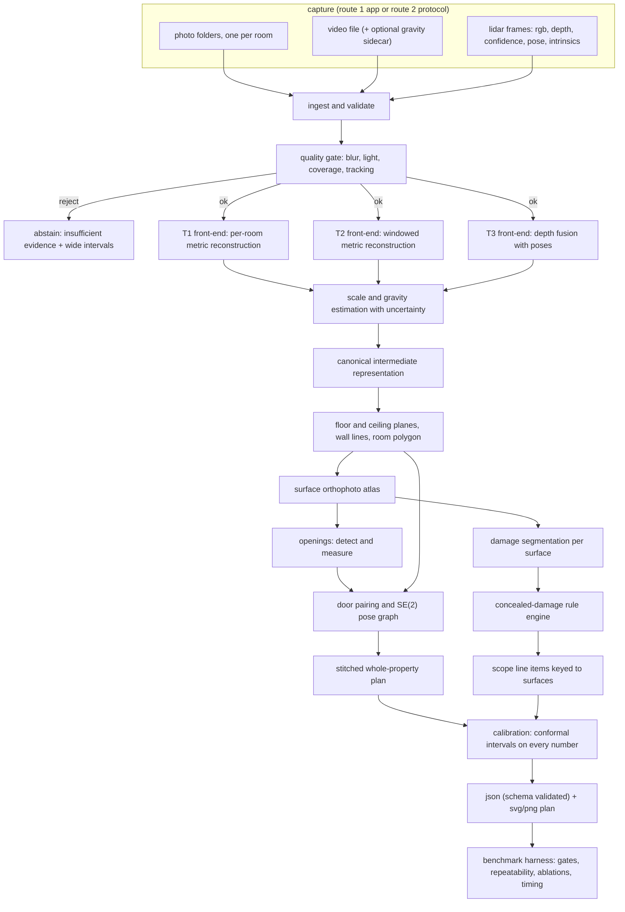

# Implementation Plan: Applied AI Engineer Case Study (Aug 2026)

**Working title:** scanplan: from phone sensors to a stitched, dimensioned, honest floor plan **Status:** DRAFT v0.1. Nothing executed. No project file touched. No git command run. **Authoring date:** 2 Oct 2026 (my environment date). **Freeze date applied to every recommendation:** 31 Aug 2026 (your rule: "everything relevant and latest according to August 2026").

> This is the one master document until you start Commit Plan 1. It is add-only: later edits append or amend through the version log in section 0.2. Sources are tagged \[S1\], \[S2\], ... and listed with recency notes in section 22. Anything I could not verify is labelled **UNVERIFIED** and is not allowed into code until a commit plan verifies it.

---

## 0. Document control

### 0.1 Contents

0 Document control · 1 Summary · 2 The assignment decoded · 3 About you · 4 Why and motivation · 5 Design principles · 6 Capture route decision · 7 Device matrix (draft) · 8 Architecture and pipeline · 9 Error budget · 10 Benchmark design · 11 Fix loop · 12 Process evidence · 13 Technology choices with references · 14 Alternatives and trade-offs register · 15 Risks · 16 Prerequisites · 17 Commit plan roadmap · 18 Key code (drafts) · 19 Q&A (open questions) · 20 Compliance matrix (draft) · 21 Defense preparation · 22 Web search log · 23 Self-review log · 24 Appendices

### 0.2 Version log (add-only)

| Version | Date | Change |
| --- | --- | --- |
| 0.1 | 2026-10-02 | First full draft. Built from `Take_Home_Assignment.pdf` and `rules_for_ai.md`. About two dozen research queries run (listed in section 22). |

### 0.3 The date discrepancy, handled explicitly

You said August 2026. My environment date is 2 Oct 2026, and searches return material up to that date. I applied your August freeze like this:

| Item | Status vs 31 Aug 2026 | What I do |
| --- | --- | --- |
| Xcode 27, iOS 27, Swift 6.4 (released 14 Sep 2026) \[S5\] | POST-AUG | Not required. Plan builds with the Xcode 26.x line that was current in August, deployment target iOS 17+. Xcode 27 builds are allowed only if you approve. App Store Connect will require the iOS 27 SDK for uploads only from April 2027 \[S5\], so Xcode 26.x uploads remain valid for this assignment. |
| PyTorch 2.14 (released), 2.15 GA planned 28 Oct 2026 \[S18\] | POST-AUG (2.14 date not confirmed) | Lock with `exclude-newer = "2026-08-31"` in uv so the resolver cannot pick post-freeze releases. Exact torch version is whatever resolves. |
| GTSAM 4.3.0 stable tag \[S15\] | POST-AUG (date not confirmed; 4.3.0-alpha.1 appeared 4 Aug 2026, 4.2.2 on 31 Jul 2026) | Plan avoids GTSAM entirely (see 8.8 and 14). |
| pydantic 2.14 | Beta only on 6 Aug 2026 \[S17\] | Use 2.13.x (2.13.4 dated 6 May 2026). |
| iPhone 18 generation | UNVERIFIED whether it exists | Device matrix is written for iPhone 15 to 17 as the assignment says "iPhone 15 or newer". |

If you prefer "latest as of today" instead of the August freeze, say so (Q7). Both are cheap to support.

### 0.4 How this document complies with your rules

| Rule | How it is honoured here |
| --- | --- |
| Not allowed 1: no state-changing git | None run. Commit plans will contain commit messages for you to run yourself. |
| Not allowed 2: no execution before "execute" | No code executed, including sandbox runs. Research was web search and page fetch only. All code in section 18 is draft text. |
| Not allowed 3: no out-of-scope file changes | Only this artifact was created. |
| Not allowed 4 and 10: no deprecated APIs; every suggestion referenced with recency | Section 13 gives a source and a recency note per choice. SceneKit and ARSCNView are explicitly excluded because deprecated \[S4\]. Unverified items are quarantined as UNVERIFIED. |
| Not allowed 5: trade-offs and alternatives | Sections 6, 8, 13, 14 give alternatives, pros and cons per decision. |
| Not allowed 6: no straying | Scope here is the implementation plan only. Commit plans come later. |
| Not allowed 7: commit plans need project analysis | The project is empty today; CP0 will start by inspecting it. Roadmap in section 17 is an outline, not a commit plan. |
| Not allowed 8 and new rule on comments | All code comments in section 18 are lowercase and few. No emojis in code. |
| Not allowed 9: no sudo | None used or proposed. Prerequisites avoid root commands. |
| Not allowed 11: validate every variable | Draft code validates and transforms inputs at every boundary (section 18). |
| New: "do not assume, ask" | Section 19 holds the questions. Section 3 and 6 list what I refused to assume. |
| New: "be concise, not verbose" vs your instruction today to be exhaustive | You asked for everything here, so this document is long. I kept sentences short and used tables to avoid padding. |
| Workflow: add-only artifacts | See 0.2. |

---

## 1. Summary

**The problem.** Build a pipeline that turns what an iPhone can capture of a property (loose photos per room, a walkthrough video, or LiDAR depth with poses) into one stitched, dimensioned floor plan with per-room walls, ceiling height, floor area and openings; per-surface damage regions with metric extent; concealed-damage flags that name the rule that fired; scope line items keyed to surfaces; and a confidence interval on every number. The same output contract must come from all three input tiers, with intervals that widen honestly as sensor data thins. You also own the capture side: either an iOS app or a written protocol for a stock app.

**How you are judged.** A live defense where they capture a space you have never seen with their phone and score your output against a laser measurer on the spot (30%); a fix loop where you name your worst gate, predict a fix, ship it and show before/after (25%); verified benchmark accuracy across all tiers (15%); compliance matrix (10%); head-to-head against an incumbent app (10%); capture route quality (5%); process evidence in git history (5%).

**The five bets this plan makes.**

1. **One geometry core, three front-ends.** Every tier is converted into the same intermediate form: gravity-aligned, metric-scale points and camera poses, plus an explicit uncertainty on scale and gravity. Everything downstream (layout, openings, damage, stitching, output) is tier-agnostic and only reads the uncertainty.
2. **Metric wall orthophotos as the measuring surface.** Each wall, floor and ceiling is unwrapped into a metric top-view-style image. Openings become rectangles whose width is read in metres, and damage becomes regions whose area is read in square metres. This turns two hard 3D problems into easy 2D ones and works for all tiers.
3. **One pose-graph solver for stitching.** A small SE(2) least-squares solver places rooms. Which factors it receives depends on the tier: door-to-door coincidence (all tiers), odometry and loop closure (video and LiDAR), no-overlap penalty and sequence prior (photos). Drift handling and the photo-tier stitch become the same mechanism with an ablation switch.
4. **Calibrated honesty over bravado.** Intervals come from split conformal calibration of normalised residuals, evaluated by leave-one-room-out coverage. An abstention path outputs "insufficient evidence" rather than a confident number when inputs are too thin. The assignment says confident garbage caps your score; this is the defence.
5. **Defensibility over cleverness.** You defend every decision live with tools closed. Where a simple component you can derive on a whiteboard (RANSAC plane fit, SE(2) least squares, split conformal) does the job, I prefer it over a library black box. Pretrained models are used where there is no sane alternative (metric reconstruction from photos, open-vocabulary segmentation).

**What is hard (honest list).** (a) The LiDAR-tier gates are tight: opening widths within 2 cm and ceiling height within 1.5 cm sit near the noise floor of a 256x192 depth map, so they need sub-pixel edge work and a bias model \[S2, S22\]. (b) Photo and video tiers have no metric scale; scale error is the dominant error term, and ±3% video and ±8% photo are only reachable with scale anchors or very good learned priors. (c) Photo-tier stitching has no shared viewpoints across rooms, so adjacency must be inferred. (d) Damage classification has no strong off-the-shelf model \[S26\]; it needs open-vocabulary segmentation plus rules. (e) Mirrors, glass, wet-look floors and low light are explicitly in scope.

**What I need from you before Commit Plan 0.** Answers to the blocking questions in section 19 (deadline, Round 1 materials, hardware, Apple account, route preference, premises).

---

## 2. The assignment decoded

### 2.1 What they are really testing

Reading between the lines of each part:

- "We provide no captures" plus "build the benchmark yourself" and "composition specified so it cannot be flattered": they test whether you measure honestly, not whether you can tune on a favourite room.
- "Same output contract from each tier" plus "confidence intervals widen honestly": they test calibrated uncertainty, not only accuracy.
- "Any picture in, results out. This is the floor": they test graceful degradation. The system must never refuse silently and never lie confidently.
- "Poses used as-is is an automatic fail": they have seen submissions that skipped drift handling.
- "A photo path that handles single rooms only fails": they have seen submissions that skipped whole-property stitching from photos.
- "Cached outputs acceptable when replay is deterministic and the live path also runs": they will run the live path at the walk-in.
- "The page cap is deliberate": they score engineering, not prose.
- "AI coding tools fully allowed; defense settles the account": they will probe whether you understand what you shipped.
- "Real properties contain mirrors, glass, wet-look surfaces and low light. Cover them": a stress set is expected in the benchmark.

### 2.2 Requirement register

IDs are used in the compliance matrix (section 20). "Source" is the assignment part. "Amb." points to open questions in section 19.

| ID | Source | Requirement | My reading | Amb. |
| --- | --- | --- | --- | --- |
| R01 | P1 | Own the capture side: Route 1 (own iOS app) or Route 2 (stock tool plus one-page protocol) | Choose one. Walk-in follows it literally on their phone. | Q5 |
| R02 | P1 R1 | Route 1: ship TestFlight or a dev build installable in under 10 minutes on their device | TestFlight public link is the only realistic path (section 6). | Q4 |
| R03 | P1 R2 | Route 2: name the tool, write a one-page protocol a non-engineer follows | Ambiguity in the page degrades the walk-in capture. | Q5 |
| R04 | P1 | Tier 1 Photos: 2 to 8 stills per room, iPhone 15 or newer, no depth, no poses, one folder per room | Inputs: folders of images only. Intrinsics only from EXIF. | none |
| R05 | P1 | Tier 2 Video: handheld walkthrough clip, iPhone 15 or newer | Input: a video file. Sidecar data is a design choice (Q16). | Q16 |
| R06 | P1 | Tier 3 LiDAR: depth, poses, intrinsics on Pro-class devices | Input: RGB-D frames with poses and intrinsics. | none |
| R07 | P1 | Same output contract at every tier, intervals widen as data thins | Interval width must be monotone in evidence quality. | Q13 |
| R08 | P1 | Device matrix: which tier on which hardware, what accuracy honestly delivered | Must be backed by measured numbers on the devices I actually own; others labelled "inferred". | Q3 |
| R09 | P2 | Per-room dimensioned plan: walls, ceiling height, floor area, openings | Core geometry. | Q9, Q10 |
| R10 | P2 | Stitched multi-room plan with correct adjacency | Rooms placed, connected, dimensioned. | Q19 |
| R11 | P2 | Per-surface damage regions: class and metric extent | Segmentation on surface orthophotos. | Q20 |
| R12 | P2 | Concealed-damage flags naming the rule that fired | Deterministic rule engine, rule id in output. | Q20 |
| R13 | P2 | Scope line items keyed to surfaces | Catalog keyed to surface ids and measured quantities. | Q20 |
| R14 | P2 | Confidence interval on every measurement | Every numeric field is an Interval object. | Q13 |
| R15 | P2 | One command per capture | `scanplan run <path>` for any tier. | none |
| R16 | P2 | JSON to the published schema | Published schema not in my possession. | Q2 |
| R17 | P2 | Rendered plan | Deterministic SVG plus PNG. | none |
| R18 | P2 | Stitched plan is the product surface, from every tier including photos | Homeowner-recognisable plan like poly.cam or magicplan. | none |
| R19 | P2 | Benchmark: one multi-room capture (3+ rooms plus connector) | Physical capture task. | Q6 |
| R20 | P2 | Benchmark: one furnished room with staged damage in two classes | Removable staged damage (section 10). | Q6, Q20 |
| R21 | P2 | Benchmark: same rooms at all three tiers, multi-room included (photos as per-room folders) | Capture plan in section 10. | Q6 |
| R22 | P2 | Benchmark: at least one room captured twice at same tier | Repeatability gate data. | Q14 |
| R23 | P2 | Laser or tape ground truth on everything; raw sensor data and measurements submitted | Surveying protocol in section 10. | Q6 |
| R24 | P2 G1 | Opening widths ≤2 cm on ≥85% of openings; misses and phantoms both count | Detection scored together with measurement. | Q10 |
| R25 | P2 G2 | Ceiling height ≤1.5 cm per room; across repeated captures spread ≤1 cm; report says "repeatable-but-biased" or "unrepeatable" | Needs bias vs spread decomposition in the report. | Q12 |
| R26 | P2 G3 | Repeatability: two captures of same room, same tier, within 1 cm or 0.5% per wall | Determinism plus capture robustness. | Q11, Q14 |
| R27 | P2 G4 | Drift accountability: state what you do about drift on multi-room capture; ablation shows footprint on and off; poses as-is is automatic fail | Pose-graph correction plus ablation. | none |
| R28 | P2 G5 | Photo-tier whole-property stitch: one plan, correct adjacency, no room overlaps, footprint ±8% with calibrated intervals | Photo stitching. | Q8 |
| R29 | P2 | Looser tier gates: photo wall lengths ±8% calibrated, video ±3%; calibration scored every tier; confident garbage caps total | Abstention and calibration. | Q13 |
| R30 | P3 | Head-to-head vs one consumer app on 2 benchmark rooms at LiDAR tier; name app and version; submit export; one table; beat or tie on ≥70% of shared dimensions | Protocol in section 10.6. | Q18 |
| R31 | P4 | Fix declaration: worst gate with failing number, root-cause hypothesis with evidence, intended fix with predicted number | One page, acknowledged before shipping. | Q1 |
| R32 | P4 | Ship the fix; before run and after run regenerable by them; readable diff | Tagged runs plus run manifests. | Q1 |
| R33 | P5 | Commit as you work; history must look like it belongs to the builder | Commit plan workflow supports this (section 12). | none |
| R34 | D1 | Compliance matrix: requirement, file path, artifact, status | Section 20 is the seed. | none |
| R35 | D2 | Capture route deliverable plus device matrix | Section 6, 7. | none |
| R36 | D3 | Repo with README to running on a fresh capture in under 15 minutes on a clean machine; one command per capture | Weight download time counts. | Q3 |
| R37 | D4 | Reproduction bundle regenerates every reported number from raw inputs; cached model outputs acceptable if replay is deterministic and live path also runs | Content-addressed cache. | Q21 |
| R38 | D5 | Benchmark report: gates at all three tiers, repeatability table, head-to-head table, timing | Auto-generated from harness. | none |
| R39 | D6 | Fix loop bundle | Before, after, diff, declaration, post-mortem. | none |
| R40 | D7 | Technical report, max 6 pages: architecture, tier design, device matrix, drift, error budget, calibration, fix loop story, known failure modes | Outline in section 24.4. | none |
| R41 | D8 | Raw benchmark data: sensor logs, ground truth, app exports | Large; delivery channel needed. | Q21 |
| R42 | Walk-in | Capture an unseen space on their iPhone 15+ following your route; run cold live; score vs laser on the spot; all three tiers ready | Frozen hyperparameters, no per-scene tuning. | Q17 |
| R43 | Constraints | Handheld consumer capture only; any pretrained model, dataset or API with disclosure; runs without calling your infrastructure | Disclosure table; offline-capable weights. | Q15 |
| R44 | Constraints | Weights and large binaries fetched by script or volume | Fetch script plus checksum plus optional USB bundle. | Q21 |
| R45 | Constraints | Mirrors, glass, wet-look surfaces, low light covered in submission | Stress set plus detectors plus widened intervals. | none |

### 2.3 Gates decoded, with measurement definitions and feasibility

Round 1 gates "apply" but I do not have Round 1; only the five additions are visible (Q2). Definitions below are proposals and become final only after your answers.

| Gate | Number | Proposed measurement definition | Why it is hard | Plan |
| --- | --- | --- | --- | --- |
| Opening widths | ≤2 cm on ≥85% of openings | Match predicted to ground-truth openings per wall by overlap along the wall (IoU ≥0.5) and type. Unmatched ground truth = miss. Unmatched prediction = phantom = miss. Pass rate = matched-within-2cm / (GT openings + phantoms). | LiDAR depth is 256x192 \[S2, S22\]. At about 2 m range one depth pixel covers roughly 9 mm (my back-of-envelope: horizontal field of view of about 60 degrees gives about 2.3 m span over 256 pixels). Two edges at ±1 pixel each is already about 1.3 cm on width. Closed doors sit almost flush with the wall, so depth alone barely sees them. | Use the 1920x1440 RGB, rectified to the wall plane, for sub-pixel jamb edges; use depth only for the plane and scale. See 8.7. |
| Ceiling height | ≤1.5 cm per room; spread ≤1 cm across repeats | abs(predicted − GT) per room, GT = median of several laser floor-to-ceiling readings. Spread = max − min over repeats. Report decomposes signed bias vs repeat spread. | A 1% range-dependent scale bias at 3 m is already 3 cm. Textureless ceilings give little visual constraint. | Two-plane fit with confidence weighting plus a range-dependent bias model calibrated on held-out rooms. See 8.7. |
| Repeatability | within 1 cm or 0.5% per wall | Per wall, abs(L1 − L2) ≤ max(1 cm, 0.005·L). (Reading of "or"; Q11.) | Two independent walks produce two independent noise draws. Determinism of code is necessary but not sufficient. | Multi-frame averaging, outlier rejection, fixed seeds, no stochastic components in the measuring path. |
| Drift accountability | report plus on/off ablation | Footprint area and perimeter of stitched plan with pose-graph correction on vs off, against GT footprint. | "Poses as-is" is an automatic fail. | SE(2) pose graph with door, Manhattan and loop factors. Real ablation plus a clearly labelled synthetic drift injection. See 8.8. |
| Photo-tier whole-property stitch | one plan, correct adjacency, no overlaps, footprint ±8% calibrated | Adjacency graph F1 vs GT; pairwise room polygon overlap area ≈ 0 (tolerance = wall thickness); footprint relative error ≤8% and interval coverage. | No poses, no depth, no shared viewpoints across folders. | Door-graph inference plus constraint placement plus alternative hypotheses. See 8.6. |
| Photo wall lengths | ±8% calibrated | Relative error per wall plus empirical coverage of stated intervals. | Scale. | Scale fusion plus conformal. See 8.4, 8.10. |
| Video wall lengths | ±3% | As above. | Scale and drift, no IMU. | Windowed metric reconstruction plus scale fusion. See 8.5. |
| Calibration at every tier | scored | Empirical coverage vs nominal at several levels; mean interval width; interval score. | Small calibration sets. | Split conformal with finite-sample quantile; honest infinite intervals when n is too small. See 8.10, 18.4. |

### 2.4 Scoring weights and where effort goes

| Weight | Component | Implication for effort |
| --- | --- | --- |
| 30% | Walk-in test | Robustness on unseen rooms beats peak accuracy on benchmark rooms. Freeze hyperparameters early. Rehearse on unseen spaces. All three tiers must run live. |
| 25% | Fix loop delta | Needs a regenerable harness from the first week. A fix that moves a gate fail to pass earns full marks. An honest post-mortem still earns points. Analysis without a shipped fix is zero. |
| 15% | Verified benchmark accuracy, three tiers | Reproduction bundle must reproduce numbers from raw data. |
| 10% | Compliance matrix | Cheap if started on day one and updated every commit. |
| 10% | Head-to-head | Needs two rooms and one competitor app run on the same day. Pre-register the tie tolerance. |
| 5% | Capture route quality | Install time, protocol clarity, non-engineer experience. |
| 5% | Process evidence | Commit plan workflow already gives this. |

### 2.5 Deliverables register

| ID | Deliverable | Owner commit plans (proposed) |
| --- | --- | --- |
| D1 | Compliance matrix | CP0 seed, updated every CP, final CP35 |
| D2 | Capture route plus device matrix | CP4 to CP8, CP29 |
| D3 | Repo and README (fresh machine under 15 minutes, one command per capture) | CP0, CP28, CP34 |
| D4 | Reproduction bundle | CP30, CP34 |
| D5 | Benchmark report | CP30, CP31 |
| D6 | Fix loop bundle | CP32, CP33 |
| D7 | Technical report (max 6 pages) | CP36 |
| D8 | Raw benchmark data | CP29 |

### 2.6 The walk-in test decoded

They bring an iPhone 15 or newer and choose the tier on the day. You follow your capture route exactly. Your pipeline runs cold, live, in front of them. They laser-measure while it runs and score on the spot. Consequences:

1. The tier is chosen by them. If their phone is a non-Pro iPhone 15, 16 or 17, the LiDAR tier is physically unavailable \[S7\]. If it is a Pro, they may still choose photos or video to test your floor.
2. "Cold" means no per-scene tuning, no cache warm-up. Cached outputs help reproduction but not the walk-in.
3. Compute at the defense is yours to bring. Unknown: do you have a GPU laptop (Q3)? Runtime must be minutes, not tens of minutes.
4. The capture route is the bottleneck. A Route 1 app crash or TestFlight install failure costs more than any algorithm point.
5. The pipeline needs a clean failure story: if a capture is poor, say so with wide intervals instead of a confident wrong number.

### 2.7 Traps I can see in the text

1. Poses used as-is on the multi-room capture: automatic fail.
2. Photo path for single rooms only: fails the photo stitch row.
3. Confident garbage on thin input caps the total score.
4. Repeatable-but-biased and unrepeatable both fail the ceiling row; the report must say which.
5. Phantom openings count as misses, so a permissive detector is punished.
6. Benchmarks that reuse one room for tuning and reporting are "flattered". Keep a dev set separate from the reported set.
7. Reproduction on their machine: weights download time and gated models (SAM 3 needs access approval \[S12\]) can blow the 15-minute budget.
8. The six-page cap and "we score the engineering" mean the report cannot substitute for working code.
9. A fix declaration without a regenerable before-run scores zero.
10. Device matrix claims that you cannot back with measurements will be probed at the defense.

### 2.8 What the document does not say (gaps that I refuse to fill by assumption)

Round 1 contract and published schema; damage class taxonomy; concealed-damage rule semantics; scope catalog; definition of footprint; definition of wall length and opening width; confidence level for intervals; whether repeatability applies to every tier; whether scale anchors in the protocol are allowed; whether hosted model APIs are acceptable; how and when the fix declaration is "acknowledged"; how to deliver large raw data; deadline and defense date. All appear in section 19.

---

## 3. About you (only what you have told me) and what it means for the plan

**Stated facts.** You go by Zed. Self-taught backend engineer with systems-programming depth and a strong interest in concurrency, event-driven design and low-level work. BTech in Civil Engineering from IIT Kanpur (June 2026). Backend and full-stack engineer at a small Mumbai OTT startup. Earlier, sole backend engineer at another startup for 12 months while still a student. Based in Mumbai.

**What follows from that (inferences, labelled as such, not stored as facts about you).**

| Observation | Consequence for the plan |
| --- | --- |
| Civil engineering background | A real edge on the domain side: surveying a room, choosing measurement references (inner wall faces, plumb, flatness), knowing typical door and ceiling dimensions, and writing a credible ground-truth protocol. The benchmark's credibility is where this pays off. I use it to propose a rigorous surveying protocol (section 10.3). |
| Backend and systems depth | Reproduction bundle, content-addressed caching, deterministic runs, one-command CLI, timing logs are comfortable territory. |
| Unknown: Swift and iOS experience | Decides Route 1 vs Route 2 (section 6). Q4. |
| Unknown: computer vision and 3D geometry experience | Drives how much I lean on simple, explainable geometry vs pretrained black boxes. Section 21 prepares defense explanations either way. |
| Unknown: GPU, Mac, iPhone, premises | Drives feasibility of everything physical. Q3, Q6. |

**What I refuse to assume** (each is a question in section 19): your hardware; your Swift experience; whether you hold an Apple Developer account; where you can capture; the deadline; whether you have Round 1 materials; whether the company allows scale markers; whether hosted model APIs are acceptable.

---

## 4. Why and motivation

**For the assignment.** The scoring table maps each component to a failure mode the company has seen: systems that only work on their author's data (walk-in), diagnosis without repair (fix loop), claims that evaporate under reproduction (verified accuracy), building a different product (compliance), benchmark avoidance (head-to-head), pipelines with no path to a user's hands (capture route), unauditable repos (process). The plan is organised to be hard to fail each of those.

**For the product.** Property claims and renovation scoping need dimensioned plans plus damage evidence. Incumbent apps (magicplan, Polycam) require LiDAR or careful AR walks and give a point estimate. A system that works from any phone photo and tells you how sure it is would extend coverage to the long tail of devices and situations. The honest-interval requirement is the commercially interesting part: a claims adjuster can act on "wall is 4.10 m ± 0.31 m (90%)" and cannot act on a confident wrong number.

**For you.** The defense rewards someone who can explain each choice. The plan is built so that every module has a one-minute explanation and a known failure mode.

---

## 5. Design principles

| # | Principle | What it means concretely | Trade-off accepted |
| --- | --- | --- | --- |
| P1 | One core, three front-ends | A canonical intermediate representation (CIR, section 8.3) is the only thing downstream code reads. | Front-ends must emit uncertainty in a common form; some tier-specific information (e.g. LiDAR confidence maps) is compressed into scalar weights. |
| P2 | Measure on rectified surfaces | Wall, floor and ceiling orthophotos at fixed metric resolution. | Needs good plane fits first; errors in the plane propagate. Mitigated by plane residual checks. |
| P3 | Uncertainty is first-class | Every number is a value plus interval plus level. Intervals come from calibration, not guesswork. | Calibration data is small; handled by finite-sample conformal and honest infinite intervals. |
| P4 | Abstain before lying | Quality gates can downgrade a capture to "insufficient evidence". | Some borderline captures yield less output; that is intended. |
| P5 | Simple and derivable beats clever | Own RANSAC, own SE(2) solver, own conformal. Libraries for linear algebra and geometry primitives only. | More of my code to review; fewer unknown behaviours at the defense. |
| P6 | Determinism by construction | Sorted inputs, fixed seeds, no stochastic code in the measuring path, content-addressed model cache. | Some library fast paths (nondeterministic GPU kernels) are disabled; slower. |
| P7 | Freeze before the walk-in | A tagged release with frozen thresholds is what runs at the defense. | No last-minute heroics. |
| P8 | Dev set and report set separated | Tune and calibrate on dev rooms; report on held-out rooms; disclose both. | Needs more captures than the minimum composition. |

---

## 6. Capture route decision (Route 1 vs Route 2)

### 6.1 Facts that drive it

- **Install path for their phone.** TestFlight external testing with a public link needs a paid Apple Developer Program membership ($99 per year \[S6\]) and the first build in a group must pass Beta App Review, typically one to two days \[S6\]. Internal testing needs no review but is limited to members of your developer team, so it cannot serve an evaluator \[S6\]. Builds expire after 90 days \[S6\]. A dev build installed from Xcode needs their phone connected to a Mac with a trusted developer profile; "under 10 minutes" is unlikely in practice.
- **LiDAR availability.** Only Pro and Pro Max iPhones from 12 Pro to 17 Pro have LiDAR; no standard, Plus or Air model does \[S7\]. So the LiDAR tier is only on Pro-class hardware in all cases.
- **Stock tools.** Stray Scanner is free and open source and records RGB, depth, confidence, poses, intrinsics and IMU per frame, transferred over a cable through Finder \[S25\]. LiDARDataCapture is a small third-party app with per-frame JSON export and nerfstudio-style transforms \[S25\]; it is data capture only. Both are developed by small teams; App Store availability can change.
- **Deprecated frameworks.** SceneKit and `ARSCNView` are deprecated as of iOS 26 \[S4\]. A new app must not use them. Use RealityKit and RoomPlan's own views, or no 3D preview at all.
- **Toolchain.** Xcode 26.x was current in August; Xcode 27 shipped 14 Sep 2026 \[S5\]. Xcode requires Apple silicon and a recent macOS \[S5\].
- **RoomPlan.** `StructureBuilder` and `CapturedStructure` exist from iOS 17 and merge multiple room scans captured under one `ARSession` or a shared `ARWorldMap` \[S1\].

### 6.2 Options

|  | Route 1: own iOS app | Route 2: stock tools plus protocol |
| --- | --- | --- |
| Capture quality control | High. Live checks of tracking state, motion, lighting, coverage; guided prompts; refuse bad captures on the spot. | Low. You rely on the evaluator following a page. "If the page is ambiguous, the capture reflects that." |
| Structured output | App writes exact folder layout and manifest; photo folders per room created automatically; can add intrinsics and exposure metadata. | Evaluator must organise folders by hand (photos) and transfer files by cable or AirDrop (LiDAR). More failure points. |
| Install on evaluator device | TestFlight public link: one tap plus install, about 3 minutes if TestFlight is present. Needs paid account and beta review lead time. | App Store install of named apps: fast, no account needed on your side. |
| Effort | High (Swift, ARKit, packaging, review). | Low code effort; high writing and testing effort for the protocol. |
| Risk | App rejection in beta review; crash on unseen iOS version; certificate expiry; Swift learning curve. | Third-party app changes or disappears; format drift; non-engineer errors. |
| Score exposure | Capture route 5%, but strongly affects walk-in (30%). | Same. |
| Defense story | You wrote the capture code and can explain every field. | You can explain the protocol and format, but the capture is not yours. |

### 6.3 Proposal (not assumed; depends on Q3, Q4, Q5)

If you have a Mac on Apple silicon, an iPhone Pro, and are willing to pay for the developer programme: **Route 1 with a deliberately boring app** (one screen, three large buttons: Photos, Video, LiDAR), no 3D preview, SwiftUI plus ARKit only, and a share-sheet export. The app earns its keep through live quality gating and automatic folder structure.

If any of those three is missing: **Route 2** with Stray Scanner for LiDAR plus the native Camera for photos and video, and a one-page protocol that includes a folder-naming trick (rooms are numbered by the order of the walk, and a printed marker page is optional).

Either way the pipeline's ingest layer reads a documented capture format (section 8.2), so the route is swappable late.

### 6.4 Decision on what the app should record per tier (Q16)

Tier definitions are about sensor content, not about the app. To stay honest in the device matrix:

| Tier | Strict reading | Optional sidecar (my proposal, needs your OK) |
| --- | --- | --- |
| Photos | Only image files, EXIF as written by the camera. | Room folder names and EXIF timestamps only. No poses, no depth. |
| Video | Only the video file. | A small JSON sidecar with the gravity vector sampled from CoreMotion. If absent, gravity is estimated from the images. The device matrix lists "video with sidecar" and "video bare" separately. |
| LiDAR | RGB, depth, confidence, poses, intrinsics, timestamps, tracking state, exposure. | None needed. |

---

## 7. Device matrix (draft; numbers are hypotheses to be replaced by measurements)

Accuracy cells stay empty on purpose. I will not pre-write numbers I cannot back. The report fills them from the benchmark, with the device used for each cell.

| Device class | Photos | Video | LiDAR | Notes |
| --- | --- | --- | --- | --- |
| iPhone 15 / 15 Plus (non-Pro) | Runs | Runs | Not available \[S7\] | Tier cells: to be measured or marked "inferred from Pro main camera". |
| iPhone 15 Pro / Pro Max | Runs | Runs | Runs \[S7\] |  |
| iPhone 16 / 16e / 17 (non-Pro) | Runs | Runs | Not available \[S7\] |  |
| iPhone 16 Pro / Pro Max, 17 Pro / Pro Max | Runs | Runs | Runs \[S7\] |  |
| Any newer model | UNVERIFIED | UNVERIFIED | Pro only, expected | Do not claim without a device. |

Rules for filling it honestly: a cell is "measured on " only if I captured on that device; otherwise "inferred, not measured". Different lens (ultra-wide vs main) is flagged because intrinsics and distortion differ.

---

## 8. Architecture and pipeline

### 8.1 Diagram



### 8.2 Modules and capture formats

Proposed package layout (details in section 18.1):

| Module | Responsibility | Depends on |
| --- | --- | --- |
| `ingest` | Detect tier from a path; load capture formats; validate every field; emit `Capture` objects | none |
| `quality` | Blur, exposure, noise, coverage, tracking-state checks; produce a quality score and reasons | ingest |
| `recon` | Tier front-ends: LiDAR fusion; video and photo metric reconstruction through pretrained models | ingest, quality |
| `scale` | Scale and gravity estimation and fusion; anchor detection | recon |
| `cir` | Canonical intermediate representation types and validators | none |
| `layout` | Floor, ceiling, walls, room polygons, ceiling height | cir |
| `atlas` | Surface orthophotos at fixed metric resolution | cir, layout |
| `openings` | Detection, edge refinement, width measurement, door normals | atlas |
| `stitch` | Door pairing, SE(2) pose graph, hypothesis enumeration, overlap checks | layout, openings |
| `damage` | Open-vocabulary segmentation on atlases, class mapping, metric extent | atlas |
| `rules` | YAML rule engine for concealed damage; scope catalog | damage, layout |
| `uncertainty` | Residual models, split conformal, interval propagation | all measuring modules |
| `schema` | Pydantic output models, JSON Schema export, published-schema adapter | none |
| `render` | Deterministic SVG and PNG plan | schema |
| `bench` | Ground-truth loader, gate computation, ablations, report tables | schema |
| `cli` | `scanplan run`, `scanplan bench`, `scanplan repro` | all |

**Capture format for Route 1 (what my app writes).**

```
capture_<uuid>/
  manifest.json                 tier, device model, os version, app version, start time, room labels, checksums
  lidar/
    frames.jsonl                one record per saved frame (index, timestamp, pose 4x4, intrinsics 3x3, tracking state, exposure, light)
    rgb/000000.jpg ...          full-resolution camera frames
    depth/000000.f32            raw float32 metres, row-major, width x height from manifest
    conf/000000.u8              raw uint8 confidence 0..2
  video/
    clip.mov
    sidecar.json                optional gravity samples
  photos/
    01_<room>/IMG_0001.heic ...
    02_<room>/...
```

**Capture format for Route 2.** Stray Scanner's documented layout \[S25\] is read by an adapter; photos come as AirDropped folders the evaluator renames by number.

### 8.3 Canonical intermediate representation (CIR)

All front-ends produce a `CIR` per capture:

| Field | Meaning |
| --- | --- |
| `frames[]` | camera poses in a gravity-aligned metric world frame (y up), intrinsics, image reference, per-frame quality |
| `points` | fused point cloud with per-point weight (from confidence, range, view angle) |
| `scale` | log-scale estimate and standard deviation (zero-ish for LiDAR; larger for video and photos) |
| `gravity` | up vector and angular standard deviation |
| `tier` | T1, T2 or T3 |
| `quality` | scalar score in 0 to 1 plus reasons |
| `provenance` | model names, revisions, config hash, seed |

Downstream modules read only the CIR. They never branch on tier except through `scale`, `gravity` and `quality`.

### 8.4 Scale and gravity estimation (all tiers)

**Gravity.**

- T3: ARKit world frame is gravity aligned (documented behaviour of world tracking; to be re-verified in the first iOS commit plan).
- T2 with sidecar: mean CoreMotion gravity direction.
- T2 bare and T1: Manhattan-frame fit. Estimate three orthogonal dominant directions from surface normals of the reconstructed points (maximise aligned-normal mass), then choose which axis is up using the camera's expected roll prior (phones are held upright) and floor-below-ceiling-above ordering. Output an angular uncertainty. Failure mode: rooms with strongly non-orthogonal walls; handled by falling back to the floor-plane normal.

**Scale (log-space fusion).** For T1 and T2 the reconstruction models give metric-ish scale with unknown error. Combine independent estimates in log space with inverse-variance weights and robust outlier handling:

| Estimate | Source | Typical role |
| --- | --- | --- |
| s_model_A | MapAnything metric output \[S9\] | primary |
| s_model_B | Monocular metric geometry, e.g. MoGe-2 \[S10\] or Depth Anything 3 metric series \[S8, S28\], compared against A on the same frames | cross-check and variance estimate |
| s_anchor | Printed fiducial of known size (optional protocol element, Q15), detected with a classical marker detector and solved by PnP | tight (about 1% or better, to be measured) |
| s_prior | Detected doors or switch plates vs. typical dimensions | weak prior with wide variance; used only after its error is measured on the dev set |

If model estimates disagree beyond a tolerance (for example a factor of 1.15), the variance is inflated and the quality score drops. A scale anchor, when present and consistent, dominates the fusion. Without an anchor, intervals stay wide and say why.

**Why I do not trust monocular scale alone.** Recent work still describes scale ambiguity as the central unresolved issue for monocular metric geometry \[S10\]. The benchmark will measure the actual error; the plan does not assume it is small.

### 8.5 Video and LiDAR front-ends

**T3 LiDAR front-end.**

1. Load frames sorted by timestamp. Drop frames whose tracking state is not normal.
2. Depth is 256x192 and RGB 1920x1440 in the common iPhone and iPad capture setup \[S2, S22\]. Scale intrinsics to depth resolution before back-projection.
3. Keep depth where confidence is high; optionally medium for sparse regions. Apple's own guidance for noisy depth is to filter by the confidence map, use smoothed depth, and upsample with a guided filter \[S3\]. I will use confidence filtering first and record whether `smoothedSceneDepth` helps in a benchmark ablation (an option in the app).
4. Back-project into the ARKit world frame; voxel-downsample deterministically (sorted voxel keys).
5. Weight points by confidence, range and view angle.
6. Output CIR with `scale` variance set from a calibrated range-dependent bias model (section 8.7).

**T2 video front-end.**

1. Decode with a standard decoder; sample frames by combined criteria: sharpness (variance of Laplacian), minimum baseline proxy (feature displacement), and cap the total (memory). Deterministic selection.
2. Intrinsics from video metadata and the camera model; refine with the reconstruction model when it predicts intrinsics.
3. Process in overlapping windows through the metric reconstruction model (MapAnything accepts images with optional intrinsics and returns metric points and cameras \[S9\]); align windows by similarity transforms using shared frames; close loops using revisit detection; run a global pose-graph step. Memory is the constraint: MapAnything needs a few gigabytes of accelerator memory and a minimum of about 8 GB was quoted for a deployment \[S27\]; window size is set from available memory.
4. Fuse scale as in 8.4.
5. Alternative considered: classic structure-from-motion. More precise on textured scenes, but indoor walls are textureless and runtime is high; kept as an optional cross-check only.

### 8.6 Photo front-end and photo-tier whole-property stitch

**Per-room reconstruction.** For each folder: read EXIF (focal length, 35 mm equivalent focal length, lens model, orientation, timestamp). Run the metric reconstruction model on the room's images as one multi-view set. If views overlap well, you get cameras and points; if not, fall back to single-image metric geometry per photo and combine through a rectilinear room-box fit. Room box fit: robustly fit horizontal floor and ceiling and up to four orthogonal walls to the union of points; unobserved walls are completed from the box and flagged as inferred (this increases the interval).

**Adjacency inference.** Photos in different folders share no poses. Evidence available:

1. Folder order and EXIF timestamps: the order the rooms were walked.
2. Doorway views: a photo taken in room A that looks through a door into room B overlaps with photos in B. Pairwise cross-folder registration with the reconstruction model's covisibility cues (the model advertises covisibility prediction \[S9\]) gives an adjacency score.
3. Door pairing: an opening in A and an opening in B with consistent widths, heights, and type.
4. Protocol: a capture rule such as "in each room, take one photo from the doorway you entered through" strengthens (2) and (3).

**Placement.** Each room is a local polygon with door segments and normals. Adjacency edges (A.door_i ↔ B.door_j) become door-coincidence factors in the same SE(2) solver as multi-room video and LiDAR (8.8). Add a no-overlap hinge penalty and a sequence prior. Enumerate a small set of hypotheses (door assignments, mirror flips), solve each, score by residual plus overlap plus consistency, output the best and record the number of near-equal alternatives. If two hypotheses differ in adjacency, the plan includes an `alternatives` field and widens the footprint interval. Footprint is largely insensitive to arrangement (it is mostly the sum of room areas plus walls), which makes the ±8% footprint gate achievable even when arrangement is uncertain; adjacency correctness is scored separately.

### 8.7 Layout, ceiling height, openings (shared by all tiers)

**Floor and ceiling.** Histogram points along gravity; take the lowest and highest dense peaks; refine each with weighted RANSAC plane fitting inside a slab (deterministic, fixed seed; code in 18.3). Ceiling height is the perpendicular distance between the two planes at the room centroid, with the weighted standard error of both fits. Apply a range-dependent bias model (a low-order function of mean observation range, fitted on dev rooms against laser ground truth) and report the bias-corrected value. Keep the uncorrected value in the debug output so the report can say "repeatable but biased" or "unrepeatable" with numbers.

**Walls.** Project points between floor + 0.3 m and ceiling − 0.3 m to a top-down density image (2 cm cells). Extract dominant wall directions (histogram of horizontal normals), detect supported wall lines by RANSAC on points near walls with horizontal normals, and build the room polygon by intersecting adjacent lines in angular order. Validate against the density image: wall-line support fraction, polygon area vs occupied-cell area. Furniture occlusion is handled because evidence is only required along the visible part; lines extend to intersections. Non-rectilinear rooms are allowed (angles are not forced to 90 degrees; a soft Manhattan prior is applied only when the building is dominantly rectilinear).

**Surface atlas.** For each wall plane, render an orthographic RGB image at 3 mm per pixel using the best frames per patch (sharpness, frontality) and deterministic blending. Floor and ceiling likewise at 1 cm. The pixel size is exact in metres through the plane geometry, so measurements read from the atlas inherit only the scale and plane-fit uncertainty.

**Openings.** On each wall atlas:

1. Detect candidate openings with an open-vocabulary segmenter or detector prompted with "door", "doorway", "window", "archway" (SAM 3 offers text-prompted instance segmentation \[S12\]; Grounding-style detectors are alternatives, section 14).
2. Cross-check with geometry: in the wall plane's (u, v) parameterisation, an opening shows as a hole or recess in plane-supported points; closed doors show as flush rectangles bounded by frame lines.
3. Snap to vertical jamb edges using intensity gradients in the atlas at sub-pixel precision (parabolic peak interpolation). Width = distance between inner jamb edges (definition per Q10).
4. Remove detections that are not consistent across at least two views, to control phantoms. A phantom is as costly as a miss.
5. Emit opening records with type, width, height, sill height, wall id, position along wall, and normal.

**Reflective surfaces.** Windows and glass doors: glass returns bad LiDAR; treat as an opening class and exclude its pixels from plane fitting (8.11).

### 8.8 Multi-room stitching and drift

**Why not a heavyweight library.** A dense SLAM backend (GTSAM, g2o, Ceres) is overkill. The state is a handful of room poses, so a hand-written SE(2) least-squares solver using SciPy's robust least squares is smaller, explainable at the defense, and removes a native dependency. GTSAM 4.3.0 stable exists and adds many features, but its date is post-freeze and its wheels are large \[S15\].

**State.** One pose (x, y, θ) per room (or per room-session), plus the fixed room-local geometry.

**Factors.**

| Factor | Residual | Tier | Notes |
| --- | --- | --- | --- |
| Door coincidence | world position of door in room i minus world position of its pair in room j | all | σ about 3 cm; also requires opposing normals (σ about 2 degrees) |
| Odometry between rooms | relative pose measured from camera poses | T2, T3 | covariance grows with path length (drift model, calibrated) |
| Loop closure | relative pose from revisiting a room or shared structure | T2, T3 | detected by overlap in free-space maps |
| Manhattan angle prior | θ close to a multiple of 90 degrees, soft | all, only if dominantly rectilinear | σ about 3 degrees |
| Sequence prior | adjacent-in-order rooms should be close | T1 | weak |
| No-overlap penalty | hinge on polygon overlap area | T1, optional elsewhere | soft |

**Drift accountability (R27).**

1. Report text: state the mechanism (above) and the drift model and its calibrated parameters.
2. Ablation A (real): the same multi-room walk with pose-graph off (ARKit or reconstruction poses used as-is) vs on; compare footprint area and perimeter vs ground truth.
3. Ablation B (synthetic, labelled as such): inject a realistic drift model (heading random walk plus scale drift) into the poses of a real capture to show the correction recovers the footprint when drift is large. Needed because modern ARKit drift on a short flat walk may be small, which would make Ablation A uninformative.
4. Ablation C: remove each factor class in turn to show which matters.

**Room segmentation for continuous captures.** Build a 2D free-space map; cut at detected openings (door-based partition) into rooms; assign frames to rooms by position. Fallback protocol: one recording per room started and stopped at the doorway, which yields independent sessions linked only by door factors.

### 8.9 Damage, concealed-damage rules, scope

**Damage segmentation.** On each atlas, prompt an open-vocabulary segmenter with class phrases ("water stain", "crack", "mould", "peeling paint", per the class list from Round 1, Q20) and verify candidates with a small vision-language model for class and plausibility. Open-weight VLMs under permissive licences exist (Qwen3-VL series, Apache 2.0 for most sizes \[S14\]); a hosted API is allowed with disclosure (Q15). Public wall-defect datasets exist for crack, mould and stain \[S26\] and can be used for threshold calibration or light fine-tuning; most are small and variable in licence. Metric extent comes directly from atlas pixel size: area in m², crack length in m (skeletonised mask), maximum width in mm when resolvable.

**Honest expectation.** Damage classification is the weakest component. Quality is limited by the segmenter and by staged-damage realism. The plan reports precision and recall on the staged room and treats every damage region as an uncertain object with a score and interval.

**Concealed-damage rules (draft, to be aligned to Round 1).** A YAML rule file; each rule reads features (class, area, location on surface, adjacency, geometry anomaly) and emits a flag with `rule_id`, the feature values that fired it, the surface, and a confidence. Example rule set:

| Rule | Condition | Flag |
| --- | --- | --- |
| CD-01 ceiling stain | water-stain region on a ceiling with area above a threshold, or with a tide-line texture | possible moisture in ceiling void or insulation |
| CD-02 low wall stain | stain or mould in the lowest 0.6 m of a wall | possible moisture behind baseboard or in wall cavity |
| CD-03 sill stain | stain within 0.3 m of a window opening | possible envelope leak at window |
| CD-04 mould with stain | mould region within a set distance of a stain region | concealed moisture likely; open and inspect |
| CD-05 long crack | crack longer than a threshold, or diagonal from an opening corner | possible structural movement; recommend engineer |
| CD-06 paint distress | peeling or blistering paint region | possible moisture behind paint |
| CD-07 plane deviation (T3 only) | ceiling or wall plane residual exceeds a threshold over an area above a threshold | possible sag or swelling behind the surface |

**Scope line items.** A catalog (YAML) of generic items (for example paint ceiling, patch drywall, mould remediation, crack repair, moisture inspection) with unit, quantity formula and the surface type it applies to. Quantities are derived from measured damage regions plus a margin and carry intervals. Pricing is out of scope unless the Round 1 contract requires it.

### 8.10 Uncertainty and calibration

**Interval construction.** For each measurement type m and tier t, the model produces a point estimate ŷ and a scale parameter σ̂ (from fit residuals, scale variance, and quality score). Define a nonconformity score s = |y − ŷ| / σ̂ on calibration data and take the finite-sample conformal quantile q at the chosen level (default 90%, Q13). Interval = ŷ ± q·σ̂. Quantity propagation (areas, sums) uses first-order propagation plus a quantile re-calibration on derived quantities.

**Finite-sample honesty.** The conformal quantile is the ⌈(n+1)(1−α)⌉-th smallest score. If that index exceeds n, the quantile is infinite: with fewer than 9 calibration points at 90% you cannot claim a finite interval. The code returns infinity in that case and the renderer shows "unbounded". This is a feature, and a good defense talking point.

**Calibration data.** Dev rooms captured by me, plus optionally public datasets with laser ground truth: ARKitScenes (iPad Pro LiDAR with Faro laser scans; CC BY-NC-SA 4.0) and ScanNet++ (iPhone RGB-D video registered to laser scans) \[S22\]. Public data helps the LiDAR bias model and the scale-error spread of metric models; licences are non-commercial and must be disclosed (Q21).

**Evaluation of calibration.** Leave-one-room-out cross-validation; report empirical coverage at nominal 50, 80, 90 and 95 percent; mean interval width; interval score; reliability plot. Coverage and width are reported per tier.

**Tool choice.** MAPIE v1 provides conformal methods for regression \[S21\], but the core procedure is about 15 lines and clearer to defend; I implement it myself and may cross-check against MAPIE.

### 8.11 Stress conditions and abstention

| Condition | Detection | Effect |
| --- | --- | --- |
| Mirrors | Text-prompted segmentation ("mirror"); LiDAR points behind the wall plane that mirror RGB content; depth discontinuity inconsistent with RGB edges | Exclude from plane fits; flag `reflective_surface`; widen intervals for affected walls; never place openings from mirrored content. |
| Glass doors and windows | Segmentation plus far-range returns through the plane | Treat as openings; exclude pixels from plane fits. |
| Wet-look or glossy floors | Specular highlight fraction; depth model disagreement on the floor plane | Floor plane from multiple frames with robust weights; widen floor and ceiling intervals. |
| Low light | Exposure and ISO metadata, mean luminance, noise estimate; ARKit tracking reasons (insufficient features, excessive motion) | Quality score drops; below threshold, abstain; between thresholds, widen. |
| Motion blur | Variance of Laplacian per frame | Drop frames; if too few remain, abstain. |
| Thin photo coverage | Fewer than 2 photos in a room, or no overlap, or no corners | Room-box completion with inferred walls and wide intervals. |

**Abstention format.** The JSON carries `status: "insufficient_evidence"` per room or per capture, the reasons, and unbounded or very wide intervals. The renderer draws the room hatched.

### 8.12 Output and rendering

- **JSON.** Pydantic v2 models (2.13.x, Python 3.14 supported \[S17\]) generate a JSON Schema; the published schema (Q2) takes precedence through an adapter layer. Every numeric field is an `Interval` (value, lo, hi, level, unit). Surfaces have stable ids (`room_01.wall_03`). Rule flags carry `rule_id` and `fired_because`.
- **Plan.** Deterministic SVG written by a small renderer (walls as thick lines, door swings, window double lines, room labels, area and dimension labels with ± ranges, hatching for abstained rooms), then PNG through a pure-wheel raster path. Library choice for raster is verified in the render commit plan (UNVERIFIED for now; candidates in section 13).

### 8.13 Determinism and reproduction

- Sorted file iteration; stable hashing of inputs; fixed seeds for any randomness; RANSAC seeded; no multi-threaded reductions in the measuring path where order affects floats.
- Deterministic GPU settings where supported; documented exceptions. PyTorch publishes reproducibility notes; the exact flag list is fetched and cited in the determinism commit plan (not yet verified).
- Model outputs cached by `sha256(inputs, model revision, config)`; replay is bit-exact; the live path always runs in the walk-in. The run manifest records code revision, dependency lock hash, model revisions, seeds and timings.
- Repeatability gate: repeated captures are independent physical walks; code determinism guarantees the same capture gives the same plan, and the multi-frame averaging aims to make two captures agree.

### 8.14 CLI and timing

`scanplan run <path> [--out DIR]` auto-detects the tier from the directory (manifest first, then structure), runs the pipeline, writes JSON, SVG, PNG, a run manifest and a timing table. `scanplan bench <benchmark_dir>` runs the harness and regenerates every reported number. `scanplan repro` replays from cache and verifies hashes. Timing targets (hypotheses to be measured on your machine): T3 under 2 minutes, T2 under 6 minutes, T1 under 3 minutes for a three-room property.

---

## 9. Error budget (hypotheses, to be replaced by measurements)

Everything in "Estimate" columns is my back-of-envelope reasoning, not a measured fact. The budget exists to show which term to attack first.

### 9.1 LiDAR tier

| Target | Gate | Dominant error terms | Mitigation |
| --- | --- | --- | --- |
| Ceiling height | 1.5 cm (0.55% of 2.7 m) | range-dependent depth bias; plane fit noise; multi-path on glossy ceilings; ground-truth reading error (laser about a few mm) | bias model from dev rooms; two-plane weighted fit; many frames; repeat-spread reporting |
| Opening width | 2 cm on ≥85% | depth resolution; edge localisation; definition mismatch (frame vs clear opening); closed-door flushness; missed or phantom detections | rectified RGB atlas, sub-pixel edge, two-view consistency, explicit definition fixed before benchmarking |
| Wall length | Round 1 gate unknown | scale bias; corner occlusion; baseboard and thickness definition; wall flatness | per-wall weighted line fit; use inner face definition consistently |
| Repeatability | 1 cm or 0.5% | capture variability; drift between walks | averaging; robust fits |
| Multi-room footprint | gate by Round 1 | odometry drift; door pairing errors | pose graph; ablation |

### 9.2 Video tier (±3%)

Error contributors in relative terms: scale (dominant), reconstruction error from textureless walls, windowing seams, gravity tilt (second-order for lengths), clutter. To pass ±3% on most walls, the scale 1σ needs to be about 1.2 to 1.5% and the reconstruction 1σ about 1%. That is only plausible with a scale anchor or a strongly consistent set of model estimates. Without an anchor I expect wider errors; the report will say so with measured numbers.

### 9.3 Photo tier (±8%)

Scale 1σ about 3 to 4%, plus structure inference in unobserved parts of rooms. The gate counts errors, while the calibration score counts whether stated intervals cover them. Planning target: hit ±8% on most walls with anchors; widen intervals honestly when anchors are absent.

### 9.4 Ground-truth error

The laser reading itself has small error, but wall flatness, baseboards, door trim, and plaster thickness create definition error of the order of a few millimetres to a centimetre. I record GT at three heights per wall and use the median; the spread becomes a per-measurement GT uncertainty reported in the benchmark.

---

## 10. Benchmark design

### 10.1 Required composition turned into a concrete capture plan

| Set | Purpose | Contents | Captures (minimum) |
| --- | --- | --- | --- |
| M: multi-room | R05, R10, drift, photo stitch | One property with 3 or more rooms plus a connector (hall or corridor), walked as a loop where possible | T3 ×2 (repeat for repeatability), T3 long loop ×1 (drift stress), T2 ×1, T1 ×1 (per-room folders) |
| F: furnished damaged room | R11, R12, R13, R20 | One furnished room with staged damage in two classes (a third class optional) | T3 ×2 (repeat), T2 ×1, T1 ×1 |
| S: stress | R45 | Mirror, glass door or window wall, glossy or wet-look floor, low light (separately or combined) | T3, T2, T1 for each condition or a combined room |
| D: dev | tuning and calibration (P8) | 6 to 10 extra single rooms in different buildings with ground truth, mostly T3, some T2 and T1 | about 10 to 20 |
| H: head-to-head | R30 | Two rooms from M or F, captured with the competitor app back to back with the T3 capture | competitor app ×2 |

The same physical rooms appear at all three tiers (R21). T1 captures of M are per-room folders. Repeat captures (R22) are independent walks on the same day and, if possible, a second day with different lighting.

### 10.2 Dev set vs report set

Tune thresholds, fit the bias model and calibrate conformal quantiles on D (and optionally public data). Report gates on M, F and S, which are never used for tuning, except through leave-one-room-out when data is scarce; any such use is declared. If M and F must feed calibration because D is too small, the report says so and shows leave-one-out numbers only.

### 10.3 Ground-truth protocol (surveyor style)

| Quantity | Method | Notes |
| --- | --- | --- |
| Wall length | Laser measurer between finished inner wall faces at three heights (0.3, 1.2, 2.0 m); median reported; spread stored as GT uncertainty | Mark measurement heights with removable tape; photograph each reading. Corner not plumb: record. |
| Squareness | Both diagonals of each room | Cross-check polygon from lengths and diagonals. |
| Ceiling height | Laser from a floor mark to the ceiling at five points, three readings each | Use a small bubble level on the laser; median per point; room value is the median across points; ceiling flatness noted. |
| Openings | Clear opening width between jamb inner faces at three heights; height; sill height; frame type | Definition fixed before capturing (Q10). |
| Floor area | From the measured polygon; verified by two different triangulations | Also state the definition of area (to wall faces). |
| Wall thickness | At door reveals | Needed for footprint and door-to-door offsets. |
| Multi-room layout | Door-to-door offsets and overall interior spans | Footprint definition per Q8. |
| Damage extents | Outline regions with removable tape corners; measure outline lengths; area from polygon | Photograph before pipeline runs. |

**Blind discipline.** Ground truth is written to a CSV and committed (hash recorded) before the pipeline is run on that capture. Capture conditions (time, light, furniture state, device, battery, case) go in the manifest.

**Tools.** Laser distance measurer and a steel tape for cross-checks. I did not verify current instrument models or their specified accuracy; the commit plan that fixes the protocol will cite the datasheet of the chosen instrument (UNVERIFIED now).

### 10.4 Staged damage

Use removable, non-destructive staging with the owner's permission: printed or hand-made water-stain textures on matte paper taped flat, tape or pencil lines for cracks, dark printed patches for mould-like regions, curled paper for peeling paint. Honest limitation: staged fakes are easier or harder than real damage in unpredictable ways. The report states that precision and recall on staged damage are not evidence of real-world performance.

### 10.5 Stress set protocol

For each condition record the lights (on, off, curtains), the surfaces (mirror size, glass door, glossy tile), and the device. For each, capture T3, T2 and T1. The pipeline should produce either a correct plan with widened intervals or an abstention; a confident wrong plan is the failure to avoid.

### 10.6 Head-to-head protocol

| Item | Proposal |
| --- | --- |
| Rooms | Two benchmark rooms, one plain with several openings and one furnished. |
| App | One consumer app, free tier. Candidates: magicplan (named in the assignment as the kind of plan a homeowner recognises; reports indicate no free unlimited plan and about two free projects, which suffices for two rooms \[S24\]) or Polycam (free plan with unlimited LiDAR and Room Mode capture, free exports limited to GLTF; floor plan and blueprint exports need a paid plan \[S23\]). Verify the free-tier behaviour on the day of capture; both change often. |
| Same-day, back-to-back | Pipeline LiDAR capture and competitor capture of the same room within the same hour, same lighting and furniture state. |
| App identification | App name, version and build from the App Store listing and Settings; screenshot kept. |
| Extraction of the app's numbers | Prefer the app's own displayed dimensions (screenshots). If only a mesh is available (Polycam free), measure it with a written, tool-independent procedure by a second person or with the app's own measurement tool, and keep screenshots. This avoids accusations of biased extraction. |
| Shared dimensions | Wall lengths, ceiling height, floor area, and opening widths when the app reports them. |
| Tie rule (pre-registered) | A tie when abs(our error) ≤ abs(their error) + max(0.5 cm, 0.25%). Pre-registered before capture and committed. |
| Pass condition | Beat or tie on ≥70% of shared dimensions. Report the table and the counts. |

### 10.7 Gate computation and statistics

- All gate definitions are written as executable functions with unit tests before any run (CP15).
- Report counts and rates with the number of rooms or walls; bootstrap intervals over rooms for pass rates; no averaging that hides a failing room.
- Repeatability: per-wall pairwise differences between repeat captures, plus signed mean (bias) and standard deviation (spread) for ceiling heights across repeats; a classification line "repeatable-but-biased", "unrepeatable", "both" or "neither" per the assignment.
- Timing: wall-clock per stage and total for every run; hardware recorded.
- Pre-register: definitions, tie tolerance, which sets are dev and which are report, selection rule for "worst gate" (section 11).

### 10.8 Data layout and delivery

```
benchmark/
  manifest.yaml                one row per capture: id, property, tier, device, date, role (dev|report|stress), repeat_of
  ground_truth/<property>/*.csv, readings/*.jpg
  captures/<capture_id>/       raw sensor data in the capture formats of 8.2
  exports/<app>/<room>/        competitor exports and screenshots
  results/<run_id>/            run manifests, json, svg, png, tables
```

Raw data is large (a few hundred frames of RGB plus depth per LiDAR capture). Delivery options: git-lfs, release assets, or an external archive with checksums fetched by script (Q21). Whatever is chosen, the repo contains the manifest and checksums so the reproduction bundle can verify every file.

---

## 11. Fix loop strategy

**Mechanics.**

1. Freeze a baseline `v0` as soon as all three tiers run end to end. Tag it. Run the benchmark; store the run manifest; this is the "before run" and must be regenerable.
2. Compute each gate's "distance to pass" with a pre-registered normalisation (failing number divided by the gate threshold). The worst by that rule is the fix target. Document the rule before looking at the numbers.
3. Write the one-page declaration: (i) worst gate and failing number, (ii) root-cause hypothesis and evidence, (iii) the fix and a numeric prediction. Submit it as the company requires (Q1).
4. Ship the fix as a commit series; run the "after run"; produce a readable diff and a before/after table.
5. If the prediction is badly wrong, write the post-mortem honestly; the assignment gives marks for it.

**Candidate failure points and the fixes I would expect (all hypotheses; the benchmark picks the real one).**

| Likely worst gate | Root-cause hypothesis | Fix | Evidence to collect |
| --- | --- | --- | --- |
| Ceiling height | Range-dependent LiDAR bias; ceiling plane contaminated by lights and fans | Bias model per range band; robust plane fit with outlier class; use confidence-weighted median | Signed error vs mean range plot; per-room bias; residual maps |
| Opening widths | Phantom detections on wardrobes and mirrors; frame vs clear-opening mismatch | Two-view consistency; mirror suppression; fixed definition and jamb snapping | Confusion table; per-detection error vs edge contrast |
| Photo-tier stitch | Door-pair ambiguity; wrong adjacency | Add covisibility cue and sequence prior; enumerate hypotheses | Adjacency graph accuracy; overlap area |
| Video ±3% | Scale error in textureless walls | Scale anchor and multi-model fusion; window overlap | Per-wall relative error vs scale estimates |
| Calibration | Too few calibration points, heteroscedastic residuals | Normalised scores with σ̂ models; pooled conformal across measurement types in log space | Coverage vs nominal by tier |
| Drift | Real ablation uninformative | Strengthen with loop factors; add the long-loop capture | Footprint with and without |

**Time reserve.** Keep about 20% of the schedule for the fix loop and the reproduction work. A late fix without a regenerable before run scores zero.

---

## 12. Process evidence strategy

- Commit plan workflow gives natural, small, reviewable commits; each commit plan ends with a proposed commit message. You run git yourself, which keeps history honest.
- Commit often within a plan's scope; do not squash. Failed experiments stay in the history with an explanatory message.
- Never backdate. Keep real timestamps. Do not paste large generated blobs in one commit.
- Raw data is added in separate commits with manifests; code and data history stay separable.
- Tags: `bench-pre-registration`, `v0-baseline`, `before-fix`, `after-fix`, `freeze-walkin`.
- README section "AI assistance disclosure" stating what tools were used and where; the defense then tests understanding.

---

## 13. Technology choices with references

Status codes: **V** verified in this session (source and recency noted), **U** unverified (must be verified in a commit plan before use), **X** rejected or not used.

| Component | Proposal | Alternatives | Reference and recency | Licence | Status |
| --- | --- | --- | --- | --- | --- |
| Python | 3.13 or 3.14 (decision D-py, Q7) | 3.12 | Python 3.14 GA Oct 2025; 3.14 GC regression noted and fixed in 3.14.5 per uv notes \[S19\]; PyTorch retains 3.14 \[S18\]; Open3D supports 3.10 to 3.14 \[S16\]; pydantic supports 3.14 \[S17\]. Research repos may lag on 3.14. | PSF | V (compat of each model repo: U) |
| Package manager | uv with a lockfile and `exclude-newer` freeze date | pip, poetry, conda | uv releases Apr to May 2026 \[S19\]; option name `exclude-newer` is from my prior knowledge | MIT/Apache | V (release), U (option details) |
| Output models | pydantic 2.13.x | dataclasses plus jsonschema | 2.13.4 dated 6 May 2026 \[S17\]; 2.14.0b1 is a beta dated 6 Aug 2026, not used | MIT | V |
| Geometry | NumPy and SciPy for linear algebra, robust least squares | custom C++ | version pins to be read from lock | BSD | U |
| 2D polygons | Shapely 2.1.2 (wheels for Python 3.14 since 24 Sep 2025) \[S20\] | custom polygon code | newer release may exist | BSD | V (version), U (newer) |
| Point cloud utils | Open3D 0.20.x optional (voxel grid, I/O) | NumPy voxel hashing | Open3D lists Python 3.10 to 3.14 wheels \[S16\] | MIT | V |
| Metric multi-view reconstruction | MapAnything v1.1.3, Apache-2.0 variant `facebook/map-anything-apache`; accepts images with optional intrinsics, poses, depth; paper in 3DV 2026 \[S9\] | Depth Anything 3 (released 14 Nov 2025; any-view and nested metric series) \[S8, S28\]; VGGT; COLMAP-style SfM | released Sep 2025, code at v1.1.3 | Apache-2.0 (Apache variant) | V |
| Monocular metric cross-check | MoGe-2 (NeurIPS 2025) \[S10\] or Depth Anything 3 metric series \[S8, S28\] | Apple Depth Pro \[S11\], UniDepthV2 | 2025 papers | check each | V (existence), U (licences) |
| Open-vocabulary segmentation | SAM 3 (arXiv 20 Nov 2025; SAM 3.1 checkpoints later) \[S12\] | Grounding-style detectors, OWL-style detectors, YOLO-world-style models | Weights are gated on Hugging Face: access request needed, which affects the clean-machine fetch path | SAM License | V, with gating risk |
| Vision-language verifier | Qwen3-VL (open weights, Apache 2.0 for most sizes; 2B to 235B-A22B) \[S14\] | Hosted API with disclosure (Q15) | Flagship released 23 Sep 2025; smaller sizes in Oct 2025; newer Qwen generations may exist (UNVERIFIED) | Apache-2.0 | V (existence), U (newer) |
| Learned layout from point clouds | SpatialLM 1.1 optional comparison only \[S13\] | own line-support polygon | Weights CC-BY-NC-4.0; needs CUDA 12.4 and TorchSparse | NC | X for core; optional |
| Pose graph | Own SE(2) solver with SciPy robust least squares | GTSAM 4.3.0 \[S15\], g2o, Ceres | GTSAM 4.3.0 stable is post-freeze | BSD | V (decision), GTSAM X |
| Conformal intervals | Own split conformal (18.4); MAPIE v1 as cross-check \[S21\] | none | MAPIE v1 released in 2025 with 2026 roadmap | BSD | V |
| ARKit depth | `ARWorldTrackingConfiguration` with `sceneDepth`; `ARDepthData.depthMap` in metres; `confidenceMap` for filtering; LiDAR required \[S2\] | `smoothedSceneDepth` \[S2, S3\] | Apple documentation, copyright 2026 | Apple | V |
| RoomPlan | optional baseline and capture reference; `StructureBuilder` merges rooms under a shared `ARSession` or `ARWorldMap`; iOS 17+ \[S1\] | own pipeline only | Apple documentation 2026 | Apple | V |
| Apple UI stack | SwiftUI plus ARKit; RealityKit only if a preview is needed; **not** SceneKit or `ARSCNView` \[S4\] | UIKit | `ARSCNView` documented as deprecated for iOS 26 \[S4\] | Apple | V |
| Xcode | Xcode 26.x (August state); Xcode 27 is post-freeze \[S5\] | Xcode 27 | Xcode 27 shipped 14 Sep 2026, Swift 6.4 | Apple | V |
| Distribution | TestFlight external group with public link \[S6\] | dev build via Xcode, ad hoc | $99/year; Beta App Review for first external build; 90-day expiry | Apple | V |
| Route 2 LiDAR tool | Stray Scanner (free, open source, RGB, depth, confidence, poses, intrinsics, IMU) \[S25\] | LiDARDataCapture (third party) \[S25\], Polycam raw export (paid) | App Store listing indicates support for recent iPhones; verify current build and iOS 26/27 behaviour | open source | V, U for latest |
| Fiducial detection | OpenCV ArUco `ArucoDetector` class, not the legacy function API | AprilTag libraries | I believe the function API was deprecated in favour of the class; verify in docs | Apache-2.0 | U |
| Rasterising SVG to PNG | Pure-wheel Python library (candidates: matplotlib, Pillow-based drawing) | CairoSVG (native cairo dependency) | not yet researched | varies | U |
| HEIC and EXIF | Pillow plus pillow-heif | exifread, system tools | not yet researched | varies | U |
| Video decode | PyAV or OpenCV `VideoCapture` | ffmpeg CLI | not yet researched | varies | U |
| CLI | standard library `argparse` | Typer, Click | stdlib: no version risk | PSF | V |
| Tests and lint | pytest, ruff | none | not yet researched | MIT | U |

**Verification queue.** Every U above gets a documented lookup in CP1 (or its own CP) before use, with the source URL and release date written into that commit plan.

---

## 14. Alternatives and trade-offs register

| ID | Decision | Options | Pros | Cons | Chosen |
| --- | --- | --- | --- | --- | --- |
| A01 | Core measurement engine for LiDAR tier | (a) own fusion plus layout; (b) Apple RoomPlan output as the engine | (a) full control, same code path as other tiers, defendable; (b) fast, decent baseline, Apple-maintained | (a) more work, risk; (b) black box, iOS-only, cannot serve tiers 1 and 2, ties the result to what incumbents already ship | (a); RoomPlan kept as optional baseline and prior |
| A02 | Pose solver | GTSAM, g2o, Ceres, own SE(2) | libraries: mature; own: small, explainable, no native deps | libraries: heavy, post-freeze for GTSAM 4.3; own: more code | own SE(2) with SciPy |
| A03 | Multi-view metric reconstruction | MapAnything, Depth Anything 3, VGGT, MASt3R-style, classic SfM | feed-forward models handle textureless walls; MapAnything takes optional intrinsics, poses, depth | memory heavy; research code stability; non-deterministic kernels | MapAnything primary, DA3 cross-check |
| A04 | Layout estimation | line-support polygon, learned (SpatialLM, RoomFormer-type) | own: explainable, uses gravity; learned: handles weird rooms | own: fails on curved or cluttered rooms; learned: licences, GPU, black box | own, with SpatialLM as optional comparison |
| A05 | Segmentation | SAM 3, Grounding-style detectors, VLM-only | SAM 3 offers text-prompted masks | gated weights; heavy | SAM 3 primary, with a documented fallback detector |
| A06 | Uncertainty | split conformal, bootstrap ensembles, Bayesian | conformal: finite-sample guarantee, simple | needs calibration data; marginal not conditional | conformal on normalised residuals |
| A07 | Capture style for multi-room | continuous walk, per-room sessions | continuous: odometry factors, realistic; per-room: no drift across rooms | continuous: drift; per-room: loses odometry | continuous primary; per-room as protocol fallback |
| A08 | Scale anchor in protocol | none, printed fiducial, A4 sheet, known objects | anchor shrinks scale error dramatically | evaluator effort; may conflict with "any picture in" | optional anchor; pipeline must still work without (Q15) |
| A09 | Python version | 3.13, 3.14 | 3.14 is newest | model repos may not support it | decide in CP1 from compatibility (Q7) |
| A10 | CLI library | argparse, Typer, Click | argparse: zero dependency | argparse: less ergonomic | argparse |
| A11 | Plan rendering | own SVG writer, matplotlib, reportlab | own SVG: deterministic, small | more code | own SVG plus pure-wheel rasteriser |
| A12 | Route | Route 1, Route 2 | see 6.2 | see 6.2 | proposal in 6.3 pending Q3, Q4, Q5 |
| A13 | Depth representation | point cloud plus plane fits, TSDF mesh | planes are what walls are; mesh adds smoothing bias | mesh gives visual output | point cloud |
| A14 | Gravity for photos | Manhattan-frame fit, learned gravity | Manhattan is explainable | fails on odd geometry | Manhattan with floor-plane fallback |
| A15 | Damage classifier | zero-shot open-vocabulary plus VLM, fine-tuned detector on public data | zero-shot: no training data needed | zero-shot: noisy | zero-shot first; light calibration with public data if time allows |

---

## 15. Risks

| ID | Risk | Likelihood | Impact | Mitigation |
| --- | --- | --- | --- | --- |
| K01 | No access to a 3+ room property and a furnished room | medium | high | Secure premises first (Q6); fall back to office or campus spaces with permission |
| K02 | No GPU for reconstruction models | unknown | high | Q3; plan a smaller-window CPU or Apple-silicon path; document runtimes; pre-warm only for reproduction |
| K03 | Beta App Review delay or rejection | medium | high (Route 1) | Submit early; keep Route 2 protocol ready as a fallback |
| K04 | Gated SAM 3 weights block clean-machine setup | high | medium | Fetch with token; document; mirror a fallback detector; offer a weights volume |
| K05 | Scale error too large at video and photo tiers | high | high | Scale anchor; multi-model fusion; honest intervals |
| K06 | Photo-tier adjacency wrong | medium | medium | Hypothesis enumeration; alternatives output; protocol doorway view |
| K07 | LiDAR ceiling bias differs on their phone | medium | high | Bias model from several devices if available; widen intervals when device is unseen; report device |
| K08 | Real drift too small for a meaningful ablation | medium | medium | Add long-loop capture; labelled synthetic injection |
| K09 | Schema mismatch because Round 1 schema unavailable | medium | high | Q2; adapter layer |
| K10 | Overfitting a small benchmark | high | high | dev vs report separation; leave-one-out; honest reporting |
| K11 | Dependency drift breaks reproduction | medium | high | uv lock plus `exclude-newer`; weights checksums; clean-VM rehearsal |
| K12 | Evaluator iOS version newer than tested (iOS 27 released 14 Sep 2026 \[S5\]) | medium | high | Test the app on iOS 26 and 27 if possible; keep ARKit use conservative |
| K13 | I produce code you cannot defend | medium | high | Commit plans explain every function; section 21 defense cards; simpler algorithms preferred |
| K14 | Licence conflicts (NC datasets and weights) | medium | low to medium | Disclosure table; avoid NC weights in the core path |
| K15 | Thermal throttling or battery on long LiDAR walks | low | medium | Protocol length limits; app warns |
| K16 | Competitor free tier changes | medium | medium | Capture early; archive screenshots and versions |

---

## 16. Prerequisites

| Area | Need | Why | Status |
| --- | --- | --- | --- |
| Hardware | A Mac on Apple silicon, recent macOS (Xcode requires it \[S5\]) | Route 1 builds and TestFlight uploads | Q3 |
| Hardware | An iPhone 15 Pro or newer Pro-class phone | LiDAR tier; Route 1 testing | Q3 |
| Hardware | A non-Pro iPhone 15 or newer (borrowed is fine) | Photos and video tiers on non-LiDAR hardware for the device matrix | Q6 |
| Hardware | A machine for the pipeline: GPU or Apple silicon, RAM, disk | Reconstruction models; walk-in live run | Q3 |
| Hardware | Laser distance measurer, steel tape, tripod, small level, printable marker | Ground truth and scale anchor | Q6 |
| Accounts | Apple Developer Program ($99/year \[S6\]) | TestFlight external testing | Q4 |
| Accounts | Hugging Face account and token | Gated SAM 3 weights \[S12\] | to do |
| Access | Premises: 3+ rooms plus connector, a furnished room, permission for staged damage and mirrors | Benchmark | Q6 |
| Software | uv, Python, Xcode 26.x, Git | Toolchain | CP0/CP1 |
| Time | Schedule reserve for physical captures and fix loop | See section 17 | Q1 |

---

## 17. Commit plan roadmap (outline only, not commit plans)

Numbering follows your rule (start at Commit Plan 0). Each real commit plan will contain file changes, all code, explanations per function and line, trade-offs, alternatives, references with recency, verification plan and a proposed commit message. Dates are not given because the deadline is unknown (Q1). Effort shares are relative.

| CP | Scope | Output | Verification idea |
| --- | --- | --- | --- |
| 0 | Inspect empty project; repo skeleton, uv project, lint config, README stub, compliance matrix seed, rules mirror | repo layout | file listing review |
| 1 | Verify every U in section 13; lock dependencies with freeze date; model fetch script skeleton; determinism helper | lockfile, `scripts/fetch_weights` | lock reproducible on clean checkout |
| 2 | Output schema v0 (Interval and entity models), JSON Schema export, published-schema adapter stub | `schema/` | validator tests |
| 3 | Benchmark data layout, manifest and ground-truth CSV formats, loaders, validators | `bench/io` | malformed-input tests |
| 4 | Route decision implemented: Route 1 app skeleton or Route 2 protocol draft and Stray Scanner adapter | `ios/` or `docs/protocol` | install test on your phone |
| 5 to 8 | Route 1 only: LiDAR recorder, video recorder, photo capture with room folders, export and TestFlight upload | app builds | capture on device; format validation |
| 9 | Ingest for all tiers into `Capture` objects, tier auto-detection | `ingest/` | fixtures |
| 10 | T3 depth fusion, gravity alignment, confidence filtering | CIR from LiDAR | synthetic box room test |
| 11 | Floor and ceiling extraction, ceiling height, bias model scaffold | `layout/planes` | synthetic plus first real room |
| 12 | Wall lines and room polygon | `layout/walls` | synthetic rooms with known size |
| 13 | Surface atlas | `atlas/` | metric checker board in a real wall |
| 14 | Openings detect and measure | `openings/` | one real room, GT compare |
| 15 | Gate and metric functions, evaluation harness, first end-to-end T3 report | `bench/gates` | unit tests per gate definition |
| 16 | Room segmentation, door pairing | `stitch/pairing` | M capture |
| 17 | SE(2) pose graph and ablation harness | `stitch/graph` | synthetic drift recovery test |
| 18 | Video front-end | `recon/video` | clip with known room |
| 19 | Scale fusion and anchor detection | `scale/` | known-scale clips |
| 20 | Photo per-room reconstruction and box fit | `recon/photo` | per-room folders |
| 21 | Photo-tier adjacency and placement, hypotheses | `stitch/photo` | M photo folders |
| 22 | Conformal calibration and coverage evaluation | `uncertainty/` | synthetic coverage test |
| 23 | Quality gate, abstention, stress detectors | `quality/` | stress set |
| 24 | Damage segmentation on atlases | `damage/` | F set |
| 25 | Rule engine, scope catalog | `rules/` | rule unit tests |
| 26 | Full JSON export and schema validation | `schema/export` | schema tests |
| 27 | Plan renderer | `render/` | golden SVG hashes |
| 28 | CLI, tier autodetect, timing log | `cli/` | one command per tier |
| 29 | Benchmark capture campaign and ground truth (physical work) | `benchmark/` | manifest checks |
| 30 | Baseline v0 full benchmark run (before run) | tagged results | reproduction from manifest |
| 31 | Head-to-head table | `bench/h2h` | pre-registered tie rule |
| 32 | Fix declaration (worst gate rule applied) | one page | evidence review |
| 33 | Fix shipped, after run, diff | tagged results | before/after table |
| 34 | Reproduction bundle and clean-machine README timing | bundle | clean VM run under 15 minutes |
| 35 | Compliance matrix final | matrix | row-by-row check |
| 36 | Technical report (6 pages max) | PDF or markdown | page count |
| 37 | Defense prep, freeze tag | tag | dry run |
| 38 | Walk-in rehearsal on unseen spaces, all three tiers | notes | timed run |

Effort shares (proposal): ingest, geometry core and openings 30%; stitching and drift 10%; T2 and T1 front-ends and scale 15%; uncertainty and abstention 8%; damage, rules, scope 7%; capture route 10%; benchmark campaign and harness 12%; reports and reproduction 8%. The walk-in and fix loop draw on all of them.

---

## 18. Key code (drafts, not executed; to be re-verified inside the commit plans)

Conventions: lowercase comments, few; no emojis; every boundary validates and transforms. These are drafts to show structure and validation style. They are not proven to run.

### 18.1 Repository layout

```
scanplan/
  pyproject.toml
  uv.lock
  README.md
  docs/protocol.md  docs/compliance_matrix.md  docs/plan/
  src/scanplan/
    __init__.py
    cli.py
    determinism.py
    ingest/  quality/  recon/  scale/  cir/  layout/  atlas/
    openings/  stitch/  damage/  rules/  uncertainty/  schema/  render/  bench/
  rules/concealed.yaml  rules/scope_catalog.yaml
  scripts/fetch_weights.py
  tests/
  benchmark/        (manifest and pointers; large data by fetch)
  ios/              (route 1 app, if chosen)
```

### 18.2 `pyproject.toml` skeleton

```toml
[project]
name = "scanplan"
version = "0.0.1"
requires-python = ">=3.13"
dependencies = [
  "numpy",
  "scipy",
  "shapely",
  "pydantic>=2.13,<2.14",
  "pyyaml",
]

[project.scripts]
scanplan = "scanplan.cli:main"

[tool.uv]
exclude-newer = "2026-08-31T23:59:59Z"
```

Heavy model dependencies go in optional groups (`recon`, `seg`) so core tests install fast. Version bounds beyond pydantic are filled at lock time (CP1). The `exclude-newer` option name and value format must be verified in CP1.

### 18.3 Deterministic plane fit (core of floor, ceiling and wall estimation)

```python
import numpy as np


def fit_plane_ransac(
    points: np.ndarray,
    weights: np.ndarray | None,
    *,
    iters: int,
    tol_m: float,
    min_inliers: int,
    seed: int,
) -> tuple[np.ndarray, float, np.ndarray]:
    pts = np.asarray(points, dtype=np.float64)
    if pts.ndim != 2 or pts.shape[1] != 3:
        raise ValueError("points must be (n, 3)")
    if not np.all(np.isfinite(pts)):
        raise ValueError("points contain non-finite values")
    n = pts.shape[0]
    if n < max(3, min_inliers):
        raise ValueError("not enough points")
    if not (isinstance(iters, int) and iters > 0):
        raise ValueError("iters must be a positive int")
    if not (tol_m > 0.0 and np.isfinite(tol_m)):
        raise ValueError("tol_m must be positive and finite")
    if weights is None:
        w = np.ones(n, dtype=np.float64)
    else:
        w = np.asarray(weights, dtype=np.float64)
        if w.shape != (n,) or not np.all(np.isfinite(w)) or np.any(w < 0.0):
            raise ValueError("weights must be (n,), finite, non-negative")

    rng = np.random.default_rng(seed)
    best_score = -1.0
    best_mask = None
    for _ in range(iters):
        idx = rng.choice(n, size=3, replace=False)
        a, b, c = pts[idx]
        normal = np.cross(b - a, c - a)
        norm = np.linalg.norm(normal)
        if norm < 1e-9:
            continue
        normal /= norm
        d = -float(normal @ a)
        mask = np.abs(pts @ normal + d) <= tol_m
        score = float(w[mask].sum())
        if score > best_score:
            best_score, best_mask = score, mask
    if best_mask is None or int(best_mask.sum()) < min_inliers:
        raise ValueError("no plane with enough inliers")

    inl = pts[best_mask]
    wi = w[best_mask]
    centroid = np.average(inl, axis=0, weights=wi if wi.sum() > 0 else None)
    cov = ((inl - centroid) * wi[:, None]).T @ (inl - centroid)
    eigvals, eigvecs = np.linalg.eigh(cov)
    normal = eigvecs[:, 0]
    d = -float(normal @ centroid)
    return normal, d, best_mask
```

Trade-offs: plain RANSAC with a fixed seed is deterministic and explainable; MSAC or PROSAC would converge faster; vectorised batching would speed it up. The final eigen refinement uses weighted least squares on inliers.

### 18.4 Split conformal quantile and interval

```python
import math
import numpy as np


def conformal_quantile(scores: np.ndarray, alpha: float) -> float:
    s = np.asarray(scores, dtype=np.float64)
    if s.ndim != 1 or s.size == 0:
        raise ValueError("scores must be a non-empty 1d array")
    if not np.all(np.isfinite(s)) or np.any(s < 0.0):
        raise ValueError("scores must be finite and non-negative")
    if not (0.0 < alpha < 1.0):
        raise ValueError("alpha must be in (0, 1)")
    n = s.size
    k = math.ceil((n + 1) * (1.0 - alpha))
    if k > n:
        return math.inf
    return float(np.partition(s, k - 1)[k - 1])


def interval(y_hat: float, sigma_hat: float, q: float) -> tuple[float, float]:
    if not (math.isfinite(y_hat) and math.isfinite(sigma_hat) and sigma_hat > 0.0):
        raise ValueError("y_hat and sigma_hat must be finite, sigma_hat > 0")
    if q < 0.0 or math.isnan(q):
        raise ValueError("q must be non-negative")
    if math.isinf(q):
        return (-math.inf, math.inf)
    return (y_hat - q * sigma_hat, y_hat + q * sigma_hat)
```

Scores are `abs(y - y_hat) / sigma_hat` on calibration data. At alpha 0.1 the quantile is finite only when n is at least 9, which is why small calibration sets yield unbounded intervals instead of invented ones.

### 18.5 Output interval type (pydantic v2)

```python
from typing import Literal, Self
from pydantic import BaseModel, ConfigDict, Field, model_validator


class Interval(BaseModel):
    model_config = ConfigDict(frozen=True, extra="forbid")

    value: float = Field(allow_inf_nan=False)
    lo: float
    hi: float
    level: float = Field(gt=0.0, lt=1.0)
    unit: Literal["m", "m2", "deg", "ratio"]

    @model_validator(mode="after")
    def check_order(self) -> Self:
        if self.lo > self.hi:
            raise ValueError("lo must not exceed hi")
        if not (self.lo <= self.value <= self.hi):
            raise ValueError("value must lie within [lo, hi]")
        return self
```

`lo` and `hi` allow infinity so an unbounded interval is representable; the published schema adapter decides how infinity is serialised (Q2). Both `Self` and the validators are standard for Python 3.11+ and pydantic 2.x.

### 18.6 SE(2) pose graph (drift and stitching core)

```python
import numpy as np
from scipy.optimize import least_squares


def wrap(a: np.ndarray | float) -> np.ndarray | float:
    return (a + np.pi) % (2.0 * np.pi) - np.pi


def rot(theta: float) -> np.ndarray:
    c, s = np.cos(theta), np.sin(theta)
    return np.array([[c, -s], [s, c]])


def solve_pose_graph(
    init: np.ndarray,
    odom: list[tuple[int, int, np.ndarray, np.ndarray]],
    doors: list[tuple[int, int, np.ndarray, np.ndarray, float, float]],
    anchor: int = 0,
) -> np.ndarray:
    p0 = np.asarray(init, dtype=np.float64)
    if p0.ndim != 2 or p0.shape[1] != 3 or not np.all(np.isfinite(p0)):
        raise ValueError("init must be finite (n, 3)")
    n = p0.shape[0]
    if not (0 <= anchor < n):
        raise ValueError("anchor out of range")

    def residuals(flat: np.ndarray) -> np.ndarray:
        p = flat.reshape(n, 3)
        out: list[float] = []
        out.extend((p[anchor] - p0[anchor]) * 1e3)
        for i, j, z, sig in odom:
            dp = rot(p[i, 2]).T @ (p[j, :2] - p[i, :2])
            dth = wrap(p[j, 2] - p[i, 2])
            pred = np.array([dp[0], dp[1], dth])
            diff = pred - z
            diff[2] = wrap(diff[2])
            out.extend(diff / sig)
        for i, j, di, dj, ang_i, ang_j in doors:
            wi = p[i, :2] + rot(p[i, 2]) @ di
            wj = p[j, :2] + rot(p[j, 2]) @ dj
            out.extend((wi - wj) / 0.03)
            opp = wrap((ang_i + p[i, 2]) - (ang_j + p[j, 2]) - np.pi)
            out.append(opp / np.deg2rad(2.0))
        return np.asarray(out, dtype=np.float64)

    sol = least_squares(residuals, p0.ravel(), loss="soft_l1", f_scale=1.0)
    if not sol.success:
        raise RuntimeError("pose graph did not converge")
    return sol.x.reshape(n, 3)
```

Notes: `odom` entries are (i, j, measured \[dx, dy, dtheta\] in frame i, sigma vector). `doors` entries are (i, j, door position in room i local, door position in room j local, door normal angle in room i local, door normal angle in room j local). The anchor term pins room 0. Manhattan, loop closure and overlap factors are added as further residual blocks in the pose graph commit plan. Soft-L1 loss gives robustness to bad door pairings. The solver is deterministic given the initial values.

### 18.7 Determinism helper

```python
import os
import random


def seed_everything(seed: int) -> None:
    if not isinstance(seed, int) or isinstance(seed, bool) or seed < 0:
        raise ValueError("seed must be a non-negative int")
    random.seed(seed)
    os.environ.setdefault("CUBLAS_WORKSPACE_CONFIG", ":4096:8")
    try:
        import torch
    except ImportError:
        return
    torch.manual_seed(seed)
    torch.use_deterministic_algorithms(True, warn_only=True)
```

The exact list of flags and their effect on each device (CUDA, Apple MPS, CPU) is UNVERIFIED and is fetched from PyTorch's reproducibility documentation in the determinism commit plan. `PYTHONHASHSEED` only matters if set before interpreter start, so the CLI sets it in a re-exec or the README documents it.

### 18.8 CLI entry (argparse, no extra dependency)

```python
import argparse
import sys
from pathlib import Path


def build_parser() -> argparse.ArgumentParser:
    parser = argparse.ArgumentParser(prog="scanplan")
    sub = parser.add_subparsers(dest="command", required=True)
    run = sub.add_parser("run", help="process one capture")
    run.add_argument("path", type=Path)
    run.add_argument("--out", type=Path, default=Path("out"))
    run.add_argument("--seed", type=int, default=0)
    bench = sub.add_parser("bench", help="run the benchmark harness")
    bench.add_argument("benchmark_dir", type=Path)
    repro = sub.add_parser("repro", help="replay cached results and verify hashes")
    repro.add_argument("bundle_dir", type=Path)
    return parser


def main(argv: list[str] | None = None) -> int:
    args = build_parser().parse_args(argv)
    if args.command == "run":
        path = args.path.resolve()
        if not path.exists():
            print(f"error: {path} does not exist", file=sys.stderr)
            return 2
        if args.seed < 0:
            print("error: seed must be non-negative", file=sys.stderr)
            return 2
        from scanplan.pipeline import run_capture
        return run_capture(path, args.out.resolve(), args.seed)
    return 0
```

### 18.9 Route 1: LiDAR recorder core (Swift draft)

Scope: record RGB, depth, confidence, pose, intrinsics and metadata per saved frame. Uses ARKit world tracking and scene depth documented for LiDAR devices \[S2\]. No SceneKit \[S4\]. Concurrency details (Swift 6 strict mode, non-Sendable buffers) are decided in the iOS commit plan after reading the then-current docs.

```swift
import ARKit
import CoreImage
import Foundation
import simd

struct FrameRecord: Codable {
    let index: Int
    let timestamp: Double
    let transform: [Float]
    let intrinsics: [Float]
    let imageWidth: Int
    let imageHeight: Int
    let depthWidth: Int
    let depthHeight: Int
    let tracking: String
    let exposureDuration: Double
    let ambientIntensity: Double?
}

final class LidarRecorder: NSObject, ARSessionDelegate {
    private let session = ARSession()
    private let queue = DispatchQueue(label: "scanplan.writer", qos: .userInitiated)
    private let ciContext = CIContext()
    private let directory: URL
    private var index = 0
    private var lastSavedTransform: simd_float4x4?
    private var pending = 0
    private let maxPending = 6
    private(set) var dropped = 0

    init(directory: URL) throws {
        guard ARWorldTrackingConfiguration.supportsFrameSemantics(.sceneDepth) else {
            throw RecorderError.lidarUnavailable
        }
        self.directory = directory
        super.init()
        for sub in ["rgb", "depth", "conf"] {
            try FileManager.default.createDirectory(
                at: directory.appendingPathComponent(sub),
                withIntermediateDirectories: true)
        }
        session.delegate = self
    }

    func start() {
        let config = ARWorldTrackingConfiguration()
        config.frameSemantics = [.sceneDepth]
        config.planeDetection = []
        session.run(config, options: [.resetTracking, .removeExistingAnchors])
    }

    func stop() { session.pause() }

    func session(_ session: ARSession, didUpdate frame: ARFrame) {
        guard case .normal = frame.camera.trackingState,
              let depth = frame.sceneDepth,
              moved(frame.camera.transform),
              pending < maxPending else {
            if pending >= maxPending { dropped += 1 }
            return
        }
        lastSavedTransform = frame.camera.transform
        let i = index
        index += 1
        pending += 1
        let snapshot = Snapshot(frame: frame, depth: depth)
        queue.async { [weak self] in
            self?.write(snapshot, index: i)
        }
    }

    private func moved(_ t: simd_float4x4) -> Bool {
        guard let last = lastSavedTransform else { return true }
        let d = simd_length(t.columns.3 - last.columns.3)
        return d > 0.03
    }
}

enum RecorderError: Error { case lidarUnavailable, writeFailed }
```

Not shown (written in the commit plan with full explanations): `Snapshot` (retains the pixel buffers), `write` (JPEG encode through `CIContext`, raw float32 depth copy under `CVPixelBufferLockBaseAddress`, raw uint8 confidence copy, JSONL append, decrement of `pending` on the main queue), and a manifest writer. A `moved` rule based on translation only is a simplification; rotation-only sweeps need an angle criterion. Tracking state and confidence handling follow Apple's documented behaviour \[S2, S3\].

### 18.10 Concealed-damage rules (YAML draft)

```yaml
version: 1
rules:
  - id: CD-01
    name: ceiling_stain
    when:
      class: water_stain
      surface: ceiling
      area_m2_min: 0.10
    flag: possible moisture in ceiling void
    confidence_from: region_score
  - id: CD-02
    name: low_wall_stain
    when:
      class: [water_stain, mould]
      surface: wall
      height_max_m: 0.6
    flag: possible moisture behind baseboard or in wall cavity
    confidence_from: region_score
  - id: CD-07
    name: plane_deviation
    when:
      tier: T3
      surface: [wall, ceiling]
      plane_residual_m_min: 0.01
      area_m2_min: 0.25
    flag: possible sag or swelling behind surface
    confidence_from: geometry
```

Thresholds shown are placeholders to be set from Round 1 definitions (Q20) and the dev set. The engine validates the file against a schema, rejects unknown keys, and records the feature values that fired each rule.

### 18.11 Output sketch (abridged)

```json
{
  "schema_version": "0.1",
  "capture": {"id": "...", "tier": "T3", "device": "...", "status": "ok"},
  "rooms": [{
    "id": "room_01",
    "ceiling_height_m": {"value": 2.71, "lo": 2.69, "hi": 2.73, "level": 0.9, "unit": "m"},
    "floor_area_m2": {"value": 14.8, "lo": 14.5, "hi": 15.1, "level": 0.9, "unit": "m2"},
    "walls": [{"id": "room_01.wall_01", "length_m": {"value": 4.02, "lo": 3.99, "hi": 4.05, "level": 0.9, "unit": "m"}}],
    "openings": [{"id": "room_01.wall_01.open_01", "type": "door", "width_m": {"value": 0.91, "lo": 0.89, "hi": 0.93, "level": 0.9, "unit": "m"}}],
    "damage": [],
    "flags": [],
    "scope": []
  }],
  "adjacency": [{"a": "room_01", "b": "room_02", "via": "room_01.wall_01.open_01", "confidence": 0.93}],
  "footprint_m2": {"value": 48.3, "lo": 46.9, "hi": 49.8, "level": 0.9, "unit": "m2"},
  "provenance": {"code_rev": "...", "lock_hash": "...", "models": [], "seed": 0}
}
```

---

## 19. Q&A: open questions

Per your rule I do not guess implicit meaning. Each question lists why it matters, options, and my proposal, which is a proposal and not an assumption. **B** = blocks Commit Plan 0 or 1. Please answer with the ID and your choice.

### 19.1 Your situation

| ID | Question | Why it matters | Options | My proposal |
| --- | --- | --- | --- | --- |
| Q1 B | What are the submission deadline, the defense date, and how and when is the fix declaration "acknowledged" and by whom? | Sets the schedule and when to freeze `v0` | dates; email to the company; portal | Work backwards: freeze 3 days before the defense, fix declaration after the baseline run |
| Q2 B | Do you have the Round 1 contract: published JSON schema, damage classes, concealed-damage rules, scope catalog, Round 1 gates (wall lengths, area, others)? | The output must match it; gates in 2.3 are incomplete without it | have it / ask the company / not available | If unavailable, ask the company for it once, and build to my draft with an adapter layer |
| Q3 B | Exact hardware: Mac model and chip and macOS; iPhone model(s) and iOS version; the machine that runs the pipeline (OS, RAM, GPU or Apple silicon, disk); what you will bring to the defense | Decides Route 1 feasibility, model sizes, runtime | free text | none |
| Q4 B | Do you hold, or are you willing to buy, an Apple Developer Program membership ($99/year \[S6\])? How much Swift and ARKit experience do you have? | Route 1 needs both; review lead time is days | yes/no; none/some/strong | Route 1 only if yes to membership and at least some Swift |
| Q5 B | Route preference after reading section 6? | Biggest scope fork | Route 1, Route 2, undecided | Route 1 if Q3 and Q4 allow, else Route 2 |
| Q6 B | Where can you capture: a property with 3 or more rooms plus a connector; a furnished room; permission to stage damage and use mirrors; a second non-Pro iPhone to borrow; a laser measurer (own, borrow, buy) | The benchmark is physical | free text | Secure premises before writing capture code |
| Q7 | Dependency freeze: 31 Aug 2026 (your rule) or today? Python 3.13 or 3.14? | Lockfile and compatibility | freeze Aug / latest; 3.13 / 3.14 | Freeze Aug; decide Python in CP1 from compatibility checks |

### 19.2 Specification ambiguities (ask the company, or confirm my reading)

| ID | Question | Options | My proposal |
| --- | --- | --- | --- |
| Q8 | What exactly is "footprint" (interior floor area union, outer envelope including wall thickness, sum of room areas)? | three definitions | Union of interior room polygons plus connector, stated explicitly; also report the envelope |
| Q9 | Wall length reference: inner face to inner face? At what height? Along baseboard or wall? | per question | Inner finished faces at mid height, median of three heights |
| Q10 | Opening width: clear opening between jambs or including frame? Do archways and passages without doors count? Do windows count? | per question | Clear width between jamb inner faces; doors, passages, windows all counted as openings with a type |
| Q11 | Repeatability "1 cm or 0.5% per wall": pass if within either, or within the larger? | either / larger / smaller | Larger of the two |
| Q12 | Ceiling "spread across captures ≤1 cm": max minus min, or standard deviation? | range / SD | Range |
| Q13 | Nominal confidence level for intervals and the calibration scoring rule | 80 / 90 / 95 percent | 90 percent, with coverage reported at several levels |
| Q14 | Does the repeatability requirement apply to every tier, or LiDAR only? Do the photo and video gates require repeat captures? | all / LiDAR | Repeats at T3 mandatory; T2 and T1 repeats when time permits and reported separately |
| Q15 | Are printed scale markers in the protocol acceptable? Are hosted model APIs (a VLM) acceptable given "any pretrained model, dataset or API with disclosure"? | yes/no each | Marker optional with fallback; open-weight VLM by default and hosted API only with disclosure |
| Q16 | May the app record a gravity sidecar with video, or must the video tier be strictly a clip? | strict / sidecar | Sidecar optional, matrix lists both variants |
| Q17 | For the walk-in: can you ask for lighting, door and furniture states, and how long does the capture window last? | ask the company | Ask once |
| Q18 | Which incumbent app (magicplan or Polycam or other) and is screen-measured data acceptable as "its export" when free tiers limit file exports? | per option | magicplan if its free tier shows dimensions; else Polycam with in-app measure screenshots plus GLTF |
| Q19 | How is adjacency scored (graph edges between rooms, connector counted)? | per question | Edge F1 on the room adjacency graph where the connector is a node |
| Q20 | Damage classes (names and definitions), concealed-damage rule semantics, scope item catalog and units, pricing needed or not | from Round 1 | Use Round 1; otherwise my draft in 8.9 |
| Q21 | How are large raw data and weights delivered (git-lfs, archive link, USB)? Is the evaluator machine online? Is the 15-minute clean-machine budget inclusive of downloads? | per question | Checksummed archive plus fetch script, with a weights volume as backup |

### 19.3 Working preferences

| ID | Question | Options | My proposal |
| --- | --- | --- | --- |
| Q22 | Repo name and licence | `scanplan` / other; MIT / none | `scanplan`, MIT, noting NC data and weights separately |
| Q23 | Single monorepo including `ios/`? | yes/no | yes |
| Q24 | Commit plan size: one concern per plan (as in 17) or larger bundles? | small / bundled | small |
| Q25 | Should I treat Apple RoomPlan as an optional baseline inside the benchmark (not as the engine)? | yes/no | yes, labelled clearly |

### 19.4 Assumptions I explicitly did not make

Round 1 contents; any schema field names beyond my draft; that scale anchors are allowed; that you have a GPU; that your phone is a Pro; that you know Swift; that the evaluator's phone runs a particular iOS; that the company accepts screenshots as app exports; that SAM 3 access is already granted to you.

---

## 20. Compliance matrix (draft seed for D1)

Status values: `planned`, `in progress`, `done`, `blocked`. File paths are proposals.

| Requirement | File path (proposed) | Artifact | Status |
| --- | --- | --- | --- |
| R01 to R03 capture route | `ios/` or `docs/protocol.md` | TestFlight link or one-page protocol | planned |
| R04 to R06 tiers | `src/scanplan/ingest/`, `recon/` | pipeline runs per tier | planned |
| R07, R14, R29 intervals and calibration | `src/scanplan/uncertainty/` | calibration report | planned |
| R08 device matrix | `docs/device_matrix.md` | table with measured cells | planned |
| R09 to R10 plan and stitch | `layout/`, `stitch/` | JSON plus SVG | planned |
| R11 to R13 damage, flags, scope | `damage/`, `rules/` | JSON fields | planned |
| R15 one command | `src/scanplan/cli.py` | `scanplan run` | planned |
| R16 schema | `src/scanplan/schema/` | JSON Schema export plus adapter | blocked on Q2 |
| R17 render | `src/scanplan/render/` | SVG and PNG | planned |
| R19 to R23 benchmark set | `benchmark/` | manifest, data, ground truth | planned |
| R24 to R28 gates and ablation | `bench/` | benchmark report tables | planned |
| R30 head-to-head | `bench/h2h/` | table plus exports | planned |
| R31 to R32 fix loop | `docs/fix/` | declaration, before, after, diff | planned |
| R33 process | git history | tags and messages | in progress once CP0 starts |
| R36 to R38 repo, reproduction, report | `README.md`, `repro/`, `docs/benchmark_report.md` | clean-machine run | planned |
| R40 technical report | `docs/technical_report.md` | six pages max | planned |
| R41, R44 raw data and weights | `benchmark/`, `scripts/fetch_weights.py` | archive and checksums | planned |
| R42 walk-in | tag `freeze-walkin` | rehearsal notes | planned |
| R43 disclosure | `docs/disclosure.md` | model, dataset, API table with licences | planned |
| R45 stress cases | `benchmark/` stress set | results | planned |

---

## 21. Defense preparation (build it as we go)

Every module gets a one-minute card: what it does, the equation or procedure, why this method, what breaks it, what you would do next. Starter cards:

| Module | Be able to say |
| --- | --- |
| Plane RANSAC | Sample three points, count inliers within a tolerance, keep the best, refit by weighted least squares on inliers. Seeded, so repeatable. Breaks on dominant clutter planes; mitigated by slab constraints and gravity. |
| Ceiling bias model | Error grows with range, so fit signed error vs mean observation range on dev rooms and subtract. Report corrected and uncorrected so "repeatable but biased" is visible. |
| Atlas | Orthographic render of a fitted plane at a fixed metres-per-pixel; every pixel has a known physical size. |
| Opening width | Sub-pixel jamb edges on the atlas; width equals pixel distance times metres per pixel; phantoms removed by multi-view agreement. |
| Pose graph | Unknowns are room poses; residuals are door coincidence, odometry, angle prior; robust loss; ablation shows effect. |
| Scale fusion | Combine independent scale estimates in log space by inverse variance; disagreement inflates variance; anchor dominates when present. |
| Conformal | Scores are normalised residuals; the quantile uses the ⌈(n+1)(1−α)⌉-th order statistic; infinite when n is too small; coverage tested by leave-one-room-out. |
| Abstention | Quality score below a threshold produces "insufficient evidence"; confident garbage is the failure to avoid. |
| Determinism | Sorted inputs, seeds, deterministic kernels where available, content-addressed cache; live path always runs. |

---

## 22. Web search log

All fetched or searched on 2 Oct 2026. "Recency" is what the source itself shows. Third-party summaries are marked; primary sources are preferred where I could reach them.

| ID | What I looked up | Source | Finding used | Recency |
| --- | --- | --- | --- | --- |
| S1 | RoomPlan multi-room API | developer.apple.com/documentation/roomplan (StructureBuilder, CapturedStructure, scanning-the-rooms-of-a-single-structure) | iOS 17+; merging rooms needs shared `ARSession` or saved `ARWorldMap`; docs copyright 2026 | current docs |
| S2 | ARKit scene depth | developer.apple.com/documentation/arkit/ardepthdata and displaying-a-point-cloud-using-scene-depth | depth map in metres; confidence map; `sceneDepth` and `smoothedSceneDepth`; LiDAR required | current docs |
| S3 | Depth noise handling | developer.apple.com/forums/thread/680849 | filter by confidence, smoothed depth, guided upsampling | older forum thread; advice still consistent with S2 |
| S4 | SceneKit status | developer.apple.com/documentation/arkit/arscnview.md | `ARSCNView` marked deprecated for iOS 26; use RealityKit (WWDC25 session 288) | current docs |
| S5 | Xcode 27, iOS 27 | mactech.com (10 Sep 2026); blakecrosley.com/blog/xcode-27-release (third-party summary of Apple notes) | Xcode 27, iOS 27 and Swift 6.4 on 14 Sep 2026; Apple silicon and macOS Tahoe 26.6 required; iOS 27 SDK needed for uploads from April 2027 | Sep 2026 (post-freeze) |
| S6 | TestFlight rules | developer.apple.com/TestFlight; docs.expo.dev/submit/testflight (21 Jul 2026); newly.app guide (Sep 2026) | external testers need Beta App Review on the first build; public links; $99/year; 90-day expiry; internal testers limited to team members | 2026 |
| S7 | LiDAR devices | help.roomsketcher.com (May 2026); simplywise.com (7 Jul 2026) | LiDAR on Pro and Pro Max 12 Pro to 17 Pro only | 2026 |
| S8 | Depth Anything 3 | github.com/bytedance-seed/depth-anything-3 (via search index); blog.roboflow.com/depth-anything-3 | released 14 Nov 2025; any-view, metric and nested series | Nov 2025; licences per checkpoint UNVERIFIED |
| S9 | MapAnything | github.com/facebookresearch/map-anything (v1.1.3); arxiv.org/abs/2509.13414; huggingface.co/facebook/map-anything-apache | metric multi-view reconstruction; optional intrinsics, poses, depth; Apache-2.0 variant; 3DV 2026 | Sep 2025 paper, repo 2026 |
| S10 | MoGe-2 and metric scale | arxiv.org/abs/2507.02546 (NeurIPS 2025); arxiv.org/pdf/2606.02379 | metric monocular geometry exists; scale ambiguity still a central problem (June 2026 paper) | Jul 2025; Jun 2026 |
| S11 | Apple Depth Pro | machinelearning.apple.com/research/depth-pro | zero-shot metric monocular depth without intrinsics | 2024; licence UNVERIFIED |
| S12 | SAM 3 | github.com/facebookresearch/sam3; arxiv.org/abs/2511.16719 | text-prompted instance segmentation; SAM 3.1 checkpoints; checkpoint access request required | Nov 2025 |
| S13 | SpatialLM | github.com/manycore-research/SpatialLM; arxiv.org/abs/2506.07491 | layout from point clouds; weights CC-BY-NC-4.0; CUDA 12.4 | v2 Nov 2025 |
| S14 | Qwen3-VL | simonwillison.net/2025/Sep/23/qwen3-vl; model directories | open weights, sizes from 2B to 235B-A22B, Apache-2.0 for most | Sep to Oct 2025 |
| S15 | GTSAM | github.com/borglab/gtsam/releases/tag/4.3.0; registry.bazel.build (4.2.2 on 31 Jul 2026, 4.3.0-alpha.1 on 4 Aug 2026) | 4.3.0 stable exists, post-freeze | Aug to Sep 2026 |
| S16 | Open3D | github.com/isl-org/Open3D/discussions/7564 | 0.20.0 supports Python 3.10 to 3.14 | 2026 (exact date UNVERIFIED) |
| S17 | pydantic | pypi.org/project/pydantic/2.13.4; 2.14.0b1 | 2.13.4 on 6 May 2026; 2.14 beta on 6 Aug 2026; Python 3.14 supported | 2026 |
| S18 | PyTorch | dev-discuss.pytorch.org notice on 2.15 and Python 3.10; PyTorch Python 3.14 support PRs | 2.14 released; 2.15 GA 28 Oct 2026; 3.14 retained | Sep 2026 |
| S19 | uv and Python 3.14.5 | release notes quoted in dependency-bot pages (Apr to May 2026) | uv active in 2026; Python 3.14 GC regression to be reverted in 3.14.5 | May 2026 (secondary source) |
| S20 | Shapely | src.opensuse.org/pool/python-Shapely | 2.1.2 (24 Sep 2025) with Python 3.14 wheels | newer may exist |
| S21 | MAPIE | mapie.readthedocs.io | v1 live; 2026 roadmap | 2025 to 2026 |
| S22 | Public datasets | github.com/apple/ARKitScenes; arxiv.org/abs/2308.11417 | ARKitScenes: iPad LiDAR with Faro ground truth, CC BY-NC-SA 4.0; ScanNet++: iPhone RGB-D registered to laser scans | 2021 and 2023 |
| S23 | Polycam free tier | learn.poly.cam export article; skyebrowse.com (3 Jul 2026) | free exports GLTF only; floor plan export on paid plan | Jul 2026 |
| S24 | magicplan | illustrarch.com review; help.magicplan.app | no unlimited free plan; around two free projects; exports in several formats | undated, 2026 era |
| S25 | Route 2 tools | github.com/strayrobots/scanner; apps.apple.com Stray Scanner; mwm.ai LiDARDataCapture | raw RGB-D, confidence, poses, intrinsics, IMU; per-frame JSON | 2026 listings |
| S26 | Damage datasets | universe.roboflow.com wall-defect datasets | crack, mould, stain, paint defect classes; small, mixed licences (one CC BY 4.0) | 2022 to 2026 |
| S27 | MapAnything memory | docs.openedgeplatform.intel.com scenescape mapping service | about 8 GB minimum quoted for deployment | 2026.2 release |
| S28 | DA3 metric formula | github.com/KouseiChoki/da3 (mirror) | metric depth from network output via focal length scaling | Nov 2025 |

**Not found or not confirmed.** RoomPlan changes in iOS 27; Open3D 0.20.0 release date; GTSAM 4.3.0 release date; PyTorch version current on 31 Aug 2026; Xcode 26.x exact minor on 31 Aug 2026; magicplan free-tier export behaviour today; licences of DA3 checkpoints, MoGe-2 and Depth Pro; whether newer Qwen VL generations exist; OpenCV ArUco API status.

---

## 23. Self-review log

Two passes were made before presenting. Nothing was executed; the checks were reading and a read-only text search of this file.

**Pass 1: correctness and consistency.**

| Check | Result |
| --- | --- |
| Markdown tables render (no stray pipe characters in cells) | Found three cells using absolute-value bars (ceiling height, repeatability, tie rule). Replaced with `abs(...)`. |
| Requirement IDs and question IDs cross-referenced | R04 pointed to Q14 wrongly. Fixed to none. All other Q references exist in section 19. |
| Version log claim of "22 queries" | Actual count is about two dozen. Corrected. |
| An unclear phrase in the scale prior row | Replaced with a testable statement. |
| Claims presented as fact without a source | The 9 mm per depth pixel and 1.3 cm width figures are labelled as my back-of-envelope reasoning. Error budget in section 9 is labelled as hypotheses. Device matrix accuracy cells are left empty on purpose. |
| Post-freeze items | Xcode 27, PyTorch 2.14, GTSAM 4.3.0 stable and pydantic 2.14 are all labelled post-freeze in 0.3 and not adopted. |
| Items not verified | Every one is tagged U in section 13 or listed under "Not found or not confirmed" in section 22, including the uv `exclude-newer` option, the OpenCV ArUco API status, PyTorch reproducibility flags and several licences. |

**Pass 2: rules compliance.**

| Rule | Check |
| --- | --- |
| Code comments lowercase, few, no emojis | Code blocks in section 18 contain no comments and no emojis. Prose outside code does use normal casing, which the rule does not cover. |
| Validation at every boundary | Draft Python validates shape, finiteness, ranges and types. The Swift draft validates LiDAR support and tracking state but is explicitly incomplete (`Snapshot`, `write`, manifest not shown). |
| No deprecated APIs | SceneKit and `ARSCNView` excluded \[S4\]. OpenCV legacy ArUco function API flagged to be avoided pending verification. |
| References and recency for every suggestion | Section 13 gives a source and recency for each verified item; unverified ones are quarantined. |
| Trade-offs and alternatives | Sections 6.2, 13, 14. |
| No assumption | Section 19.4 lists what was not assumed. Every proposal in Q&A is labelled as a proposal. |
| No execution, no git, no sudo | None used. |

**Known weaknesses I could not remove in this draft.**

1. Several design claims depend on Round 1 material I do not have (Q2). Section 2.3 gate definitions may change.
2. Photo and video accuracy at ±8% and ±3% depends on measured scale error of the pretrained models, which I did not measure. The plan treats it as the main risk (K05).
3. The Swift draft has not been compiled and uses APIs I confirmed only through Apple's depth documentation; other calls (for example camera exposure properties, JPEG encoding through Core Image) are re-verified in the iOS commit plans.
4. Draft Python was not run. It may contain bugs; its purpose is to show structure and validation style.
5. The roadmap has no dates because the deadline is unknown.

---

## 24. Appendices

### 24.1 Draft one-page capture protocol (Route 2 flavour; the Route 1 app replaces most steps)

1. Install (once, about 3 minutes): Stray Scanner from the App Store for LiDAR; the built-in Camera for photos and video.
2. Before you start: fully charge the phone; remove the case if it covers the camera; clean the lens; turn on all lights; open curtains; close mirrors' doors or cover them if possible; place the printed marker page flat on the floor or a wall in the first room (optional).
3. Photos: one folder per room named by walk order (01, 02, 03). In each room take 4 to 8 photos from the corners, keeping floor and ceiling lines visible. Take one photo from the doorway you entered, looking into the room. Do not zoom. Do not use portrait mode.
4. Video: hold the phone upright at chest height. Walk slowly (about one step per second). In each room, turn slowly in place once, keeping the floor-wall line in frame, then pause 2 seconds in each doorway. Finish where you started. Do not run, do not film mirrors directly.
5. LiDAR: open Stray Scanner, tap record, repeat the video walk, tap stop. Avoid pointing at mirrors and large windows for long.
6. Hand-off: AirDrop or cable the folders to the machine. Name the main folder `capture_<date>`.
7. Avoid: fast turns, low light, covering the camera or LiDAR with a finger, people walking through, pointing at the sun.

Known ambiguity risks: "slowly", "chest height", "turn in place". The protocol will use countable instructions (seconds, steps) and be tested on a non-engineer before submission.

### 24.2 Fix declaration template (one page)

```
Worst gate (rule applied, normalised distance): <gate>, failing number <value> vs threshold <threshold>
Root-cause hypothesis: <statement>
Evidence: <plots and numbers, run ids>
Fix: <what changes, files, factors, parameters>
Prediction: <gate value after fix, with reasoning>
Regeneration: before tag <tag>, after tag <tag>, command <command>
```

### 24.3 Ground-truth sheet columns

`capture_id, property, room, quantity, element_id, height_m, reading_1_m, reading_2_m, reading_3_m, median_m, spread_m, instrument, operator, timestamp, photo_ref, notes`

### 24.4 Six-page technical report outline

| Page | Content |
| --- | --- |
| 1 | Architecture diagram; tier design; device matrix |
| 2 | Geometry core; surface atlas; openings; ceiling bias handling |
| 3 | Drift and stitching with ablation figure; photo-tier stitch |
| 4 | Error budget with measured numbers; calibration analysis with coverage plot |
| 5 | Fix loop story: before, after, post-mortem |
| 6 | Known failure modes (mirrors, glass, wet-look, low light, abstentions); disclosure table; reproduction summary |

### 24.5 Glossary

CIR: canonical intermediate representation. T1, T2, T3: photo, video, LiDAR tiers. Atlas: metric orthophoto of a surface. Conformal quantile: order statistic of calibration scores guaranteeing marginal coverage. SE(2): planar rigid motions (x, y, heading). Manhattan frame: three mutually orthogonal dominant directions of a building. Phantom: predicted opening with no ground-truth match.

---

*End of Implementation Plan v0.1.*